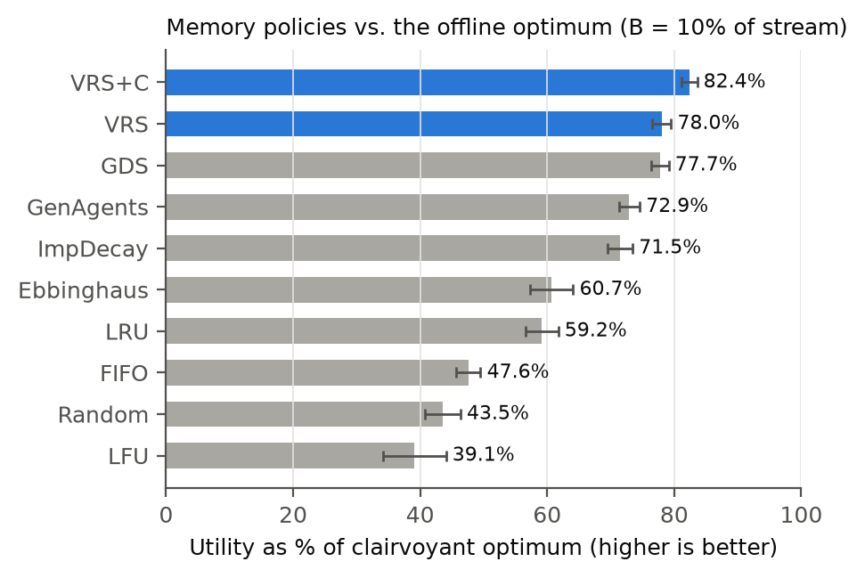
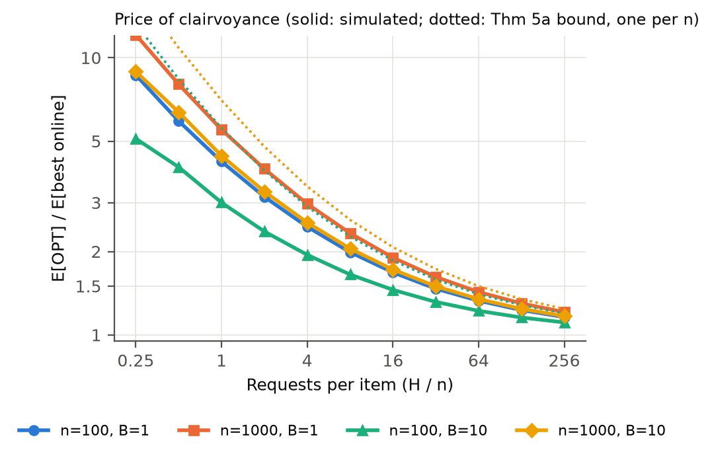
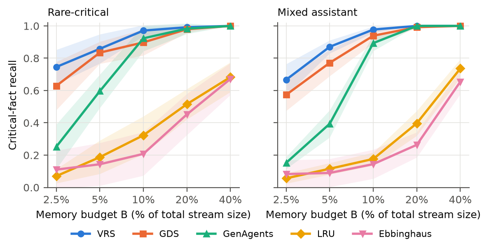
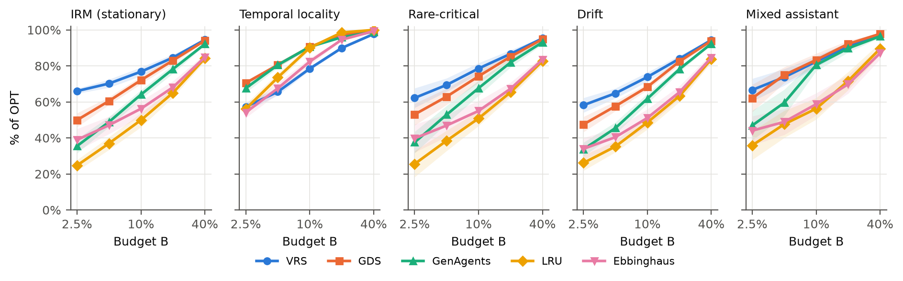
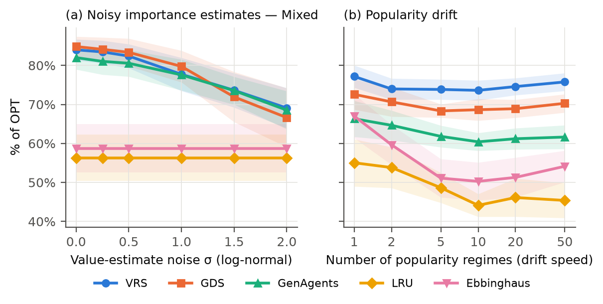
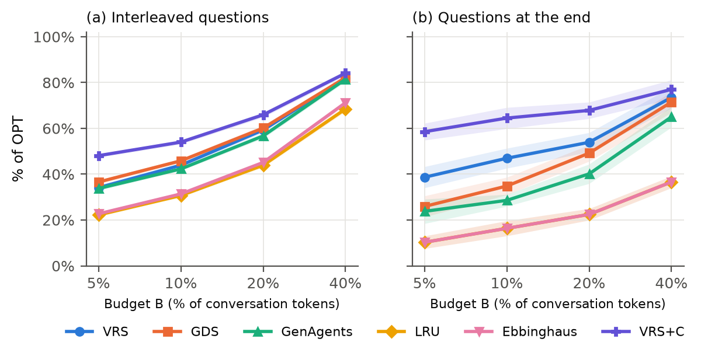

# What Should an Agent Forget? A Competitive Analysis of Memory Eviction for LLM Agents

<!--
Alternative titles:
  - Belady's Law for Agent Memory: Optimal Forgetting under Irrevocable Eviction
  - Forgetting Is Forever: Online Algorithms for Bounded Memory in LLM Agents
Target venues: arXiv (cs.AI / cs.LG, cross-list cs.DS) → NeurIPS / ICLR / AAMAS / TMLR
Length target: 8–9 pages main text + unlimited appendix
Status legend: [TODO] remaining author-specific items (name, affiliation, acknowledgments)
-->

**Authors:** Amir Hossein Khalifeh¹\*, Mehdi Gholami¹
¹ [Affiliation — TODO], Iran
\*Corresponding author: Amirkhalife.biz@gmail.com

**Code & data:** https://github.com/AmirHosseinkhalife/agent-memory-eviction

---

## Abstract

Large language model (LLM) agents increasingly rely on persistent external memory, yet every practical memory store is bounded and must decide what to forget. A rapidly growing literature proposes eviction heuristics based on recency, decay, and importance scoring, but none of them is measured against what is *achievable*, so the field cannot tell how much headroom remains. We formalize agent memory management as the **Agent Memory Eviction Problem (AMEP)**, an online problem that differs from classical caching in three ways: eviction is **irrevocable**, items have **heterogeneous sizes and values**, and some items are **rare but critical**. We prove that Belady's rule, optimal for paging, can be arbitrarily bad under irrevocability; that the offline problem is NP-hard in general but solvable by min-cost flow for uniform sizes; that **no online policy, even randomized, is competitive** in the worst case; and that every **value-oblivious** policy (LRU, LFU, FIFO, forgetting curves) can be forced to a $B/n$ fraction of the achievable utility even under a benign stochastic model. On the positive side, under an independent re-access model a value–rate–size index is $(1 - s_{\max}/B)$-competitive; with predicted values it is consistent and smooth in the sense of learning-augmented algorithms, but no policy can be robust. We further show that the **price of clairvoyance**, the gap between the best online policy and the hindsight optimum, grows as $\Theta(\log n/\log\log n)$ when requests are sparse. We release **MemSim**, an open-source simulator with an exact ILP oracle, and evaluate twelve policies on 250 synthetic instances and on **real long-term conversations from LoCoMo** (5,882 dialogue turns, 1,535 questions, 440 oracle-solved instances), with importance predicted online by an LLM. On synthetic workloads, widely used heuristics attain 39–78% of the clairvoyant optimum, versus 82.4% for our index policy with compression, and recency-based policies recall only 18–32% of critical facts, versus 97–99%. On real conversations, LLM-predicted importance (AUC 0.83 for later-needed turns) raises the utility of value-aware policies by 12–25 points, value-oblivious policies barely outperform random eviction (30–31% vs. 25% of the optimum at a 10% budget), and value-aware compression retains 2–5× more evidence than LRU at the same budget. Our results provide the first principled reference point for evaluating agent memory.

**Keywords:** LLM agents, agent memory, online algorithms, competitive analysis, caching, forgetting, Belady's algorithm

---

## 1. Introduction

### 1.1 Motivation

LLM agents are moving from single conversations to long-lived deployments: personal assistants that accompany a user for months, coding agents that work across a repository's history, and enterprise agents that serve whole teams. Such agents need memory that outlives the context window. A family of systems now provides it: MemGPT pages information between the context and external storage [8], Generative Agents retrieve memories by recency, importance and relevance [7], MemoryBank applies an Ebbinghaus forgetting curve [9], and production libraries such as Mem0 [10] and A-Mem [11] maintain evolving memory stores for deployed agents (see [12] for a survey).

Every such store is **bounded**. Retrieval quality degrades as the store grows, prompt budgets cap how much retrieved memory an agent can read, storage and embedding costs grow with the number of items, and privacy regulation limits retention. A bounded store must therefore decide, continuously, **what to forget**. The consequences of getting this wrong are concrete: a recent study shows that personal assistants compress away safety-relevant facts such as a user's allergy while retaining low-value conversational content [20].

### 1.2 The Gap

The literature on agent forgetting is large and growing [13–17], but it is almost entirely empirical: each paper compares a new heuristic against a few others on a benchmark. What is missing is a **reference point**. Without knowing the best achievable utility on a workload, a reported improvement from 61% to 64% recall cannot be interpreted: it might close most of the remaining gap or a negligible fraction of it.

Classical caching theory seems the natural source of such a reference point. Belady's algorithm gives the offline optimum for paging [1], and competitive analysis characterizes online policies such as LRU [2]. However, as we show, these results do **not** transfer. Classical caching assumes that an evicted page can be re-fetched from slower storage at a cost. Agent memory is different: once a memory is forgotten, it is **gone**; the agent cannot re-read a conversation from three months ago that it chose not to keep. Items also differ by orders of magnitude in size and in value, and the most valuable items are often the least frequently accessed.

### 1.3 Contributions

1. **Formalization.** We define the *Agent Memory Eviction Problem* (AMEP), an online problem with irrevocable eviction, variable item sizes and values, and an exogenous request process (Section 3).
2. **Offline structure.** We show that Belady's farthest-in-future rule can be arbitrarily bad under irrevocability (Proposition 1), that offline AMEP is NP-hard in general, and that it is solvable in polynomial time by min-cost flow when sizes are uniform (Theorem 1). We give an exact ILP oracle for the general case.
3. **Impossibility results.** No online policy, deterministic or randomized, has a bounded competitive ratio (Theorem 2). Every value-oblivious policy, including LRU, LFU, FIFO and forgetting curves, can be forced to a $B/n$ fraction of the achievable utility even under a benign stochastic workload (Theorem 3).
4. **A policy with guarantees.** Under an independent re-access model, the value–rate–size index policy is irrevocably implementable and $(1 - s_{\max}/B)$-competitive against every request-non-anticipating policy (Theorem 4). With predicted values it is consistent and smooth, and no policy can also be robust, which places AMEP in the learning-augmented framework (Corollary 1).
5. **Price of clairvoyance.** We bound the gap between the best online policy and the hindsight optimum from above and below (Theorem 5), and show empirically that much of any policy's distance to OPT is information-theoretic rather than algorithmic.
6. **MemSim.** An open-source simulator with five synthetic workload generators, a real-data pipeline for LoCoMo [28] with LLM-predicted importance, twelve policies, an exact offline oracle, and a reproducible experiment pipeline (Section 6).
7. **Empirical findings.** On 250 synthetic and 440 real-conversation instances: the best existing heuristics leave 22% of achievable utility unclaimed; value-oblivious policies forget critical facts more often than random eviction; LLM-predicted importance is the single largest lever on real data (+12 to +25 points); no eviction rule dominates across access patterns; and value-aware compression is the most effective intervention overall (Section 7).

### 1.4 Paper Organization

Section 2 reviews related work. Section 3 formalizes AMEP. Section 4 presents the theoretical results, and Section 5 the resulting policy. Section 6 describes MemSim, and Section 7 reports experiments on synthetic workloads (7.2–7.7) and real conversations (7.8), followed by a sensitivity analysis (7.9). Sections 8–10 discuss implications, limitations, and conclusions. All proofs are in Appendix A.

---

## 2. Background and Related Work

### 2.1 Memory Architectures for LLM Agents

MemGPT [8] treats the context window as main memory and an external store as disk, with the LLM issuing paging calls. Generative Agents [7] store an observation stream and retrieve by a weighted sum of recency, importance (LLM-rated on a 1–10 scale) and relevance. MemoryBank [9] attaches a memory strength to each item that decays along an Ebbinghaus curve and is reinforced on recall. Mem0 [10] and A-Mem [11] maintain structured, evolving stores with extraction, update and consolidation operations. A recent survey [12] organizes this space by memory form, function and dynamics. These systems define *how* memories are stored and retrieved; they treat the *capacity* decision heuristically, if at all. **Our work is complementary:** we analyze the capacity decision itself and provide a yardstick for any of these systems.

### 2.2 Forgetting and Eviction in Agent Memory

A second line of work targets forgetting directly. FadeMem [13] applies biologically inspired, importance-modulated decay; SF-AMS [14] performs strategic forgetting over structured memory; graph-based selective forgetting [15] prunes memory graphs; a multi-factor value model [16] learns what to retain; and a rate–distortion view [17] frames memory compaction as a trade-off between budget and information loss. These works report empirical gains, typically against recency or uniform baselines. Closest in spirit, [23] derives that LRU is near-optimal when the usefulness of every memory decays exponentially with age, a special case that our temporal-locality results confirm (Section 7.2), and [24] documents retention failures in which a prerequisite memory is evicted before it is ever retrieved. **None of these works compares against an optimum or provides worst-case or distributional guarantees for general workloads**, which is precisely what our oracle and theory supply.

### 2.3 Caching and KV-Cache Eviction in LLM Serving

At the systems level, KV-cache eviction for agent inference (e.g., MemDecay [18]) and prefix-cache replacement [19] have been studied extensively; notably, [19] finds that LRU remains competitive with sophisticated policies on production traces while a substantial gap to Belady's optimum persists. **These settings differ fundamentally** from ours: KV entries and prefixes can be recomputed from the source text, so a miss costs latency, not information. Agent memories are semantic records whose source is no longer available once evicted.

### 2.4 Online Algorithms and Competitive Analysis

Belady [1] proved that evicting the page requested farthest in the future is optimal for paging. Sleator and Tarjan [2] introduced competitive analysis and showed that LRU is $k$-competitive. Weighted and size-aware variants led to GreedyDual [3] and GreedyDual-Size [4], and to randomized $O(\log k)$-competitive algorithms for weighted paging [5]. Stochastic online knapsack [6] studies irrevocable *admission* of items with random sizes and values.

The closest classical model is the **removable online knapsack problem** of Iwama and Taketomi [25]: items arrive online, each must be accepted or rejected on arrival, and accepted items may later be discarded, irrevocably, to make room. This is exactly the *feasibility* structure of AMEP. The two problems differ in their *objective*. In removable knapsack, the profit is the value of the set held at the end, so only the final contents matter. In AMEP, utility accrues *over time*, each time a held item is requested, so an item's worth depends on *when* and *how often* it will be needed, and holding an item early can be valuable even if it is dropped later. This temporal objective is what makes request statistics (rates, recency) relevant and links AMEP to caching rather than to packing.

**Learning-augmented algorithms.** A recent line of work circumvents worst-case lower bounds by giving online algorithms access to (possibly erroneous) predictions, and measures performance by *consistency* (with perfect predictions), *robustness* (with arbitrary predictions), and *smoothness* (degradation with prediction error). For caching, Lykouris and Vassilvitskii [26] showed that predictions of next-request times yield an algorithm that is near-optimal with good predictions and $O(\log k)$-competitive with bad ones; see also [27]. In agent memory, an LLM-judged importance score is precisely such a prediction. Our analysis places AMEP in this framework and reveals a sharp difference from caching: under irrevocable eviction, *no* robustness guarantee is possible (Theorem 2), so all guarantees must come from consistency and smoothness (Corollary 1).

**AMEP thus combines the irrevocability of removable knapsack with the request-driven rewards of caching.** To our knowledge this combination has not been analyzed, and our results show it behaves unlike either parent problem.

---

## 3. Problem Formulation

### 3.1 Setting

Time is discrete, $t = 1, \dots, T$, with one event per step. An event is either the **arrival** of a new memory item or a **request** for a previously arrived item. Item $i$ arrives at time $a_i$ with size $s_i > 0$ (tokens) and value $v_i > 0$ (utility obtained each time it is successfully retrieved). Policies observe $s_i$ on arrival and a noisy estimate $\hat v_i$ of $v_i$ (e.g., an LLM-judged importance score); they do not observe future events. Let $A_t$ be the set of items that have arrived by time $t$.

A policy maintains a memory $M_t \subseteq A_t$ subject to the capacity constraint $\sum_{i \in M_t} s_i \le B$. When item $j$ arrives, it is inserted and the policy then evicts items (possibly $j$ itself) until the constraint holds. **Eviction is irrevocable:**

$$M_t \subseteq M_{t-1} \cup \{j_t\},$$

where $j_t$ is the item arriving at $t$ (if any). A request for item $i$ at time $t$ yields reward $v_i$ if $i \in M_t$ and $0$ otherwise.

### 3.2 Objective

A policy $\pi$ maximizes its total utility

$$U(\pi) = \sum_{t:\, e_t = \mathrm{req}(i)} v_i \cdot \mathbf{1}[i \in M_t^{\pi}].$$

We measure a policy by its **utility ratio** $U(\pi)/U(\mathrm{OPT})$, where $\mathrm{OPT}$ is the clairvoyant offline optimum that knows the entire event sequence in advance. In the stochastic analysis we also compare against $\mathrm{OPT}_{\mathrm{on}}$, the best policy that does not anticipate future requests.

> **Definition 1 (AMEP).** Given capacity $B$ and an online sequence of arrivals $(a_i, s_i, \hat v_i)$ and requests, choose memories $M_1, M_2, \dots$ with $\sum_{i \in M_t} s_i \le B$ and $M_t \subseteq M_{t-1} \cup \{j_t\}$ for all $t$, so as to maximize $U(\pi)$.

### 3.3 How AMEP Differs from Classical Caching

| Property | Classical caching | Agent memory (AMEP) |
|---|---|---|
| Eviction | Reversible (re-fetch on miss) | **Irrevocable** (unless re-observed) |
| Item size | Uniform (pages) | Variable (tokens) |
| Item value | Uniform miss cost | Heterogeneous; some items rare but critical |
| Partial retention | No | Yes — **compression/summarization** |
| Retrieval | Exact hit/miss | Noisy, degrades with store size (future work) |

The first row is decisive. In paging, a wrong eviction costs one fetch; in AMEP it forfeits *all* future value of the item. This changes which decisions are optimal (Proposition 1) and how hard the online problem is (Theorems 2–3).

### 3.4 Workload Models

Requests follow an **independent re-access model (IRM)** with time-varying popularity: at a request step $t$, item $i \in A_t$ is requested with probability $w_i(t) / \sum_{j \in A_t} w_j(t)$. Workloads differ in how $w_i(t)$ is defined:

- **IRM (stationary):** $w_i(t) = \lambda_i$, with heavy-tailed $\lambda_i$ (Pareto).
- **Temporal locality:** $w_i(t) = \lambda_i \exp(-(t - a_i)/\tau)$; recent items are more popular.
- **Rare-critical:** stationary, but a fraction of items are *critical*: high value, low popularity (allergies, credentials, deadlines).
- **Drift:** each item belongs to a topic; topic popularity is resampled at regime boundaries (changing user interests).
- **Mixed assistant:** a blend of ephemeral (fast-decaying, popular), persistent (stationary), and critical items.

For worst-case statements we also consider **adversarial** sequences.

---

## 4. Theoretical Analysis

All proofs are deferred to Appendix A.

### 4.1 The Offline Optimum

The natural first candidate for a reference policy is Belady's rule. It fails.

> **Proposition 1 (Belady fails under irrevocability).** Even with unit sizes and unit values, the farthest-in-future eviction rule can obtain a $1/L$ fraction of the optimum, for any $L \ge 1$.

*Intuition.* Belady's rule is optimal for paging because an evicted page can be fetched back later; it only needs to postpone the next miss. Under irrevocability, the right question is not *when* an item is next needed but *how much* total future value it carries. An item requested soon but only once should be sacrificed before an item requested later but many times.

Because eviction is irrevocable, any schedule holds each item over a contiguous interval starting at its arrival. This interval structure yields the exact formulation used by our oracle.

> **Theorem 1 (Complexity of offline AMEP).** (a) Offline AMEP is NP-hard, even when every item is requested exactly once. (b) If all sizes are equal, offline AMEP with arbitrary values is solvable in polynomial time by a reduction to min-cost flow.

*Exact oracle.* Let $r_{i,1} < \dots < r_{i,K_i}$ be the request times of item $i$ and let $y_{i,k} \in \{0,1\}$ indicate that $i$ is still held at its $k$-th request. Then

$$\max \sum_{i,k} v_i\, y_{i,k} \quad \text{s.t.} \quad y_{i,k} \le y_{i,k-1}, \qquad \sum_{i} s_i\, y_{i,\nu_i(t)} \le B \;\; \forall t \in \mathcal{A},$$

where $\mathcal{A}$ is the set of arrival times and $\nu_i(t)$ is the index of $i$'s first request after $t$. Memory load can only increase at arrivals, so these constraints suffice; items with no future request are dropped at no cost. We solve this ILP with HiGHS; the LP relaxation provides an upper bound.

### 4.2 Lower Bounds for Online Policies

> **Theorem 2 (No competitive online policy).** For every online policy, deterministic or randomized, every $B \ge 1$ and every $n > B$, there is an instance with unit sizes and values on which the policy's expected utility is at most $(B/n) \cdot U(\mathrm{OPT})$. Hence no online policy has a bounded competitive ratio for AMEP.

*Intuition.* After $n$ indistinguishable items arrive, any policy can keep at most $B$ of them. The adversary then repeatedly requests one that was forgotten. In paging the policy would recover by re-fetching it; under irrevocability it cannot. **Worst-case competitive analysis is therefore uninformative for agent memory**, which motivates distributional analysis and the use of value signals.

The next result shows that value signals are not merely helpful but necessary, even when requests are benign.

> **Definition 2.** A policy is **value-oblivious** if its decisions depend only on arrival times, sizes and access history, not on $\hat v_i$. LRU, LFU, FIFO, Random and Ebbinghaus-style forgetting curves are value-oblivious.

> **Theorem 3 (Value-oblivious policies fail under IRM).** For every value-oblivious policy, every $B$, every $n > B$ and every $\varepsilon > 0$, there is a stationary IRM instance with unit sizes on which the policy's expected utility is at most $(B/n + \varepsilon)$ times that of the value–rate–size index policy of Section 4.3.

*Intuition.* If $n$ items look statistically identical except for their value, a policy that ignores value keeps the one critical item with probability at most $B/n$. Recency-based forgetting is exactly this kind of policy, which explains the critical-fact failures observed in practice [20] and in Section 7.3.

### 4.3 Stochastic Setting: An Index Policy

Consider stationary IRM, $w_i(t) = w_i$, and define the **value–rate–size index**

$$\phi_i = \frac{w_i\, v_i}{s_i},$$

the expected utility per unit of memory per request. The policy **DENSITY** keeps, at every time, the longest prefix of $A_t$ sorted by decreasing $\phi_i$ whose total size fits in $B$.

> **Theorem 4 (Index policy is near-optimal, and irrevocability is free).** Under stationary IRM with known $(w_i, v_i, s_i)$: (i) DENSITY is irrevocably implementable, i.e., an item it evicts would never be re-selected; (ii) for every policy $\pi$ that does not anticipate future requests (even one that knows all future arrivals),
> $$\mathbb{E}[U(\mathrm{DENSITY})] \;\ge\; \Bigl(1 - \frac{s_{\max}}{B}\Bigr)\, \mathbb{E}[U(\pi)].$$

*Intuition.* At every request step the expected reward of any memory is bounded by a fractional knapsack over the arrived items. DENSITY's prefix is the integral part of the greedy fractional solution, losing at most one item's worth of capacity. Because new arrivals can only raise the greedy threshold, an item that falls below it never rises above it again, so the inability to reinstate evicted items costs nothing. For agent memories, $s_{\max}/B$ is small (a single memory is a few hundred tokens; budgets are tens of thousands), so the guarantee is close to 1.

> **Corollary 1 (Learning-augmented guarantee).** Suppose DENSITY uses predicted indices $\hat\phi_i$ (e.g., from an LLM importance score), fixed on arrival, with multiplicative error $\hat\phi_i / \phi_i \in [1 - \delta, 1 + \delta]$. Then it remains irrevocably implementable and
> $$\mathbb{E}[U] \;\ge\; \frac{1-\delta}{1+\delta}\Bigl(1 - \frac{s_{\max}}{B}\Bigr)\,\mathbb{E}[U(\pi)].$$

In the terminology of learning-augmented algorithms [26, 27], the policy is $(1 - s_{\max}/B)$-**consistent** and **smooth**: its guarantee degrades continuously with the prediction error $\delta$. Theorem 2 shows that no policy can additionally be **robust** to arbitrary predictions. Unlike in paging, where a predictor-based policy can fall back on LRU and retain an $O(\log k)$ guarantee, an irrevocable eviction made on a bad prediction cannot be repaired. *For agent memory, the quality of the value predictor is therefore not one factor among many: it is the only source of guarantees.*

### 4.4 The Price of Clairvoyance

Our empirical yardstick, the clairvoyant OPT, knows every future request. How much of the gap between an online policy and OPT is *unavoidable*, because the future is unknown, rather than due to a suboptimal policy? The next result answers this question for stationary workloads.

> **Theorem 5 (Price of clairvoyance).** Consider stationary IRM with $n$ items present before $H$ requests, unit sizes and values, and request probabilities $p_i \le p$. Then DENSITY is an optimal online policy, and:
> (a) **Upper bound.** $\displaystyle \frac{\mathbb{E}[U(\mathrm{OPT})]}{\mathbb{E}[U(\mathrm{DENSITY})]} \le 1 + \frac{B}{D}\Bigl(\sqrt{2Hp\ln(n+1)} + \tfrac{1}{3}\ln(n+1)\Bigr)$, where $D = H\sum_{i \in \text{top-}B} p_i$ is DENSITY's expected utility. For uniform popularity this is $1 + \sqrt{2n\ln(n+1)/H} + n\ln(n+1)/(3H)$, which tends to 1 once each item is requested $\omega(\log n)$ times.
> (b) **Lower bound.** For uniform popularity, $B = 1$ and $H = n$, the ratio is $(1 + o(1)) \ln n / \ln\ln n$.

*Intuition.* When requests are sparse, chance alone makes a few items much more popular in hindsight than in expectation; the clairvoyant OPT exploits this luck, and no online policy can. The gap is a balls-into-bins effect and vanishes only when every item is requested many times. In agent memory, most items are requested rarely or never (in our workloads, about 2.3 requests per item on average), so **a substantial part of any policy's distance to OPT is information-theoretic, not algorithmic**. We quantify this split empirically in Section 7.2 using DENSITY\*, a privileged reference that knows the true popularity and value of each item.

### 4.5 Extension: Compression as Partial Eviction

Summarization offers a third option between keeping and forgetting: an item of size $s_i$ and value $v_i$ is replaced by a summary of size $\rho s_i$ retaining value $\gamma v_i$, with $\rho < \gamma \le 1$. Compression increases the item's density by the factor $\gamma/\rho$ and is the integral analogue of the fractional fill in the knapsack bound of Theorem 4: compressing the marginal item, instead of evicting it, recovers part of the $s_{\max}/B$ integrality loss and, more importantly, keeps a trace of every item that would otherwise be lost forever. This connects AMEP to the rate–distortion view of memory compaction [17]. We evaluate compression empirically in Section 7.6.

---

## 5. Proposed Policy: VRS

DENSITY assumes known popularity and stationarity. **VRS (Value–Rate–Size eviction)** is its practical instantiation: it evicts the item with the smallest estimated index $\hat\phi_i = \hat\lambda_i \hat v_i / s_i$.

**Algorithm 1: VRS**
```
Input: capacity B, value estimates v̂, prior strength b0, half-life h
State: discounted access count c_i and last-update time for each held item

On arrival of item j at time t:
    insert j;  c_j ← 0
    while Σ_{i∈M} s_i > B:
        evict argmin_{i∈M}  λ̂_i(t) · v̂_i / s_i        # or compress it (VRS+C)
On request for item i at time t:
    if i ∈ M:  c_i ← c_i · 2^{-(t - t_i)/h} + 1      # reward v_i is collected

λ̂_i(t) = (c_i(t) + m(t) · b0) / (E_i(t) + b0)
    E_i(t): discounted exposure since arrival;  m(t): population mean request rate so far
```

**Rate estimation.** $\hat\lambda_i$ is an empirical-Bayes estimate: a Gamma-prior posterior mean that shrinks a new item's rate toward the population mean $m(t)$ with prior strength $b_0$ (in steps), so that new items are neither evicted immediately nor protected indefinitely. The half-life $h$ discounts old accesses, which makes VRS adaptive to temporal locality and drift; $h = \infty$ recovers the stationary estimator of Theorem 4.

**Value estimation.** In deployment, $\hat v_i$ can come from an LLM-rated importance score (as in Generative Agents), item type (e.g., safety-relevant facts, credentials, commitments), or explicit user signals. Corollary 1 and Section 7.5 quantify the effect of estimation noise.

**Complexity.** With a priority queue keyed by $\hat\phi_i$ and lazy updates, each operation costs $O(\log |M|)$. Our reference implementation scans memory, costing $O(|M|)$ per eviction, which is still only ≈160 µs per event in Python (Section 7.1).

**Compression variant (VRS+C).** The first time an item is selected for eviction it is compressed ($\rho = 0.25$, $\gamma = 0.6$); a compressed item selected again is evicted.

---

## 6. MemSim: Simulation Framework

### 6.1 Design

MemSim is a ~1,500-line Python package with five components.

- **Workloads** (`workloads.py`): generators for the five models of Section 3.4, parameterized by horizon, arrival rate, size/value/popularity distributions, value-estimate noise, recency time-scale, critical-item mix, and drift speed.
- **Policies** (`policies.py`): a common interface (`on_insert`, `on_access`, `decide`) and twelve policies, plus a wrapper that adds compression to any policy.
- **Simulator** (`simulator.py`): an event-driven engine that enforces capacity and irrevocability and records utility, hit rate, critical-fact recall, and runtime.
- **Oracle** (`oracle.py`): the ILP of Section 4.1, solved with HiGHS via SciPy, with LP-relaxation upper bounds.
- **Real data** (`locomo.py`, `llm.py`): converts LoCoMo conversations [28] into AMEP traces and obtains online importance predictions from any OpenAI-compatible LLM endpoint, with on-disk caching so that results are reproducible without API access.

**Verification.** A test suite checks that the ILP oracle matches exhaustive enumeration on 60 random small instances and that no online policy ever exceeds the oracle on any workload.

### 6.2 Baselines

| Policy | Description | Source |
|---|---|---|
| Random | Uniform random eviction | — |
| FIFO | Evict the oldest item | — |
| LRU | Evict the least recently used item | classical |
| LFU | Evict the least frequently used item | classical |
| GDS | GreedyDual-Size with cost $\hat v_i$ | Cao & Irani [4] |
| Ebbinghaus | Retention $e^{-\Delta t / S}$, strength $S$ grows with recalls | MemoryBank [9] |
| GenAgents | Recency $\delta^{\Delta t}$ + normalized importance | Park et al. [7] |
| ImpDecay | Importance-weighted forgetting curve | inspired by FadeMem [13] |
| **VRS (ours)** | Value–rate–size index | Section 5 |
| **VRS+C (ours)** | VRS with compression | Section 5 |
| DENSITY\* | Index policy with *true* popularity and value (privileged; not deployable) | Theorem 4 |
| **OPT** | Clairvoyant offline optimum (ILP) | Section 4.1 |

Relevance-based retrieval scores (as in Generative Agents) depend on the current query and are undefined at eviction time; we therefore retain the recency and importance terms. ImpDecay is inspired by, not a reimplementation of, FadeMem.

### 6.3 Metrics

- **Utility ratio:** $U(\pi)/U(\mathrm{OPT})$, the primary metric.
- **Critical-fact recall:** fraction of requests for critical items that are served.
- **Hit rate:** unweighted fraction of requests served.
- **Runtime:** wall-clock microseconds per event.

---

## 7. Experiments

### 7.1 Experimental Setup

**Workloads.** Each trace has $T = 3000$ events with arrival probability $0.3$ per step (≈900 items, ≈2100 requests). Sizes are log-normal with median 50 tokens ($\sigma = 0.6$, clipped to $[8, 400]$); values are log-normal ($\mu = 0$, $\sigma = 1$); base popularity is Pareto with shape 1.5. Value estimates are $\hat v_i = v_i \cdot e^{\epsilon_i}$ with $\epsilon_i \sim \mathcal{N}(0, 0.5^2)$. Temporal workloads use $\tau = 150$ steps. Critical items (5%) have 30× value and 0.15× popularity. The mixed workload contains 5% critical, 25% persistent, and 70% ephemeral items ($\tau = 75$, 3× popularity). The drift workload has 10 topics whose Dirichlet(0.5) popularity is resampled across 5 regimes.

**Budgets and seeds.** The memory budget $B$ is set to 2.5%, 5%, 10%, 20% or 40% of the total size of the stream; 10% is the default. All results are averaged over **10 test seeds** (0–9). Hyper-parameters of all tunable policies (Ebbinghaus, GenAgents, ImpDecay, VRS) were selected by grid search on **5 disjoint validation seeds** (1000–1004) at the default budget, maximizing the mean utility ratio across workloads (Appendix E).

**Oracle.** All 250 main instances were solved to a relative MIP gap of at most 0.65% (mean 0.07%), so reported utility ratios are exact up to this tolerance.

**Hardware.** Intel Core i7-14700HX, 28 logical cores, 32 GB RAM; Python 3.12, SciPy 1.18 (HiGHS). The full pipeline runs in about 23 minutes on 24 worker processes.

### 7.2 RQ1 — How far are existing heuristics from optimal?



**Figure 1.** Utility as a percentage of the clairvoyant optimum at $B = 10\%$, averaged over five workloads (error bars: 95% CI over 10 seeds).

**Table 1.** Utility as % of OPT at $B = 10\%$ (mean ± std over 10 seeds; best per column in bold).

| Policy | IRM (stationary) | Temporal locality | Rare-critical | Drift | Mixed assistant | Average |
|---|---|---|---|---|---|---|
| Random | 36.9 ± 5.7 | 71.5 ± 3.8 | 35.0 ± 8.1 | 36.7 ± 5.3 | 37.5 ± 7.9 | 43.5 ± 4.5 |
| FIFO | 37.0 ± 3.8 | 88.2 ± 0.9 | 36.6 ± 5.9 | 35.7 ± 3.2 | 40.2 ± 6.2 | 47.6 ± 3.1 |
| LRU | 49.9 ± 6.3 | 90.1 ± 1.9 | 50.9 ± 6.7 | 48.6 ± 6.2 | 56.3 ± 9.6 | 59.2 ± 4.2 |
| LFU | 48.0 ± 7.6 | 19.7 ± 6.2 | 49.1 ± 8.7 | 44.0 ± 9.1 | 34.9 ± 16.5 | 39.1 ± 8.0 |
| GDS | 72.1 ± 3.4 | **90.6 ± 1.3** | 74.2 ± 5.8 | 68.3 ± 2.8 | **83.3 ± 5.7** | 77.7 ± 2.3 |
| Ebbinghaus | 56.2 ± 6.9 | 82.4 ± 3.2 | 55.0 ± 9.0 | 51.1 ± 7.9 | 58.7 ± 9.9 | 60.7 ± 5.5 |
| GenAgents | 64.1 ± 4.1 | 90.6 ± 1.2 | 67.7 ± 6.8 | 61.8 ± 4.5 | 80.6 ± 5.5 | 72.9 ± 2.6 |
| ImpDecay | 68.2 ± 4.9 | 79.0 ± 2.4 | 70.4 ± 4.7 | 64.0 ± 4.2 | 75.9 ± 7.9 | 71.5 ± 3.1 |
| VRS | **76.8 ± 3.9** | 78.5 ± 1.7 | **78.6 ± 4.9** | **73.8 ± 4.2** | 82.4 ± 4.9 | 78.0 ± 2.4 |

Four findings stand out.

**(1) Substantial headroom remains.** The best existing heuristic, GDS, attains 77.7% of the clairvoyant optimum on average, leaving 22% of achievable utility unclaimed at $B = 10\%$. The recency- and frequency-based policies that dominate practice attain only 39–61%.

**(2) Value awareness is the dominant factor.** Every value-aware policy (GDS, GenAgents, ImpDecay, VRS) outperforms every value-oblivious one (LRU, LFU, FIFO, Ebbinghaus, Random) on average, as Theorem 3 predicts. A one-line change from LRU to GDS adds 18.6 points (paired Wilcoxon signed-rank test over 50 workload–seed pairs, $p < 10^{-12}$).

**(3) VRS is the strongest eviction rule where its model applies.** VRS is the best policy on the IRM, rare-critical and drift workloads, beating GDS by 4.3–5.5 points and winning on all 10 seeds in each ($p = 0.002$ per workload). It is statistically tied with GDS on the mixed workload ($-0.9$ points, $p = 0.08$) but trails on the temporal-locality workload (78.5% vs. 90.6%). There, every item's popularity decays from its arrival, so recency is itself a near-optimal signal; this matches the analysis of [23], which shows that LRU is near-optimal when usefulness decays exponentially with age. Averaged over workloads at $B = 10\%$, VRS and GDS are statistically indistinguishable (78.0% vs. 77.7%, $p = 0.22$). Over all budgets VRS leads by 1.3 points ($p < 10^{-3}$), and by 4.0 points when the temporal workload is excluded ($p < 10^{-19}$, wins on 77% of instances).

**How much of the gap is avoidable?** Table 4 decomposes each policy's distance to OPT using DENSITY\*, the index policy of Theorem 4 given the *true* popularity and value of every item. The **information gap** (OPT − DENSITY\*) is what no online policy can recover without knowing future requests; the **estimation gap** (DENSITY\* − VRS) is what better rate and value estimates could recover. On the stationary workloads the information gap dominates: 14–26 points of OPT, against 0–8 points of estimation gap. On the drift workload VRS reaches 99.9% of DENSITY\*, so essentially all of its remaining distance to OPT is the price of clairvoyance. On the temporal and mixed workloads, where popularity changes with item age, the estimation gap is larger (11–17 points), which identifies better non-stationary rate estimation as the main algorithmic opportunity. Figure 5 shows the same phenomenon in the setting of Theorem 5: with one request per item, the hindsight optimum is 3–5.5× better than the best online policy, and the ratio approaches 1 only slowly as requests become dense. Since agent memories are typically requested rarely, **raw "% of OPT" numbers understate how close good policies are to the best achievable online.**

**Table 4.** Gap decomposition at $B = 10\%$ (points of OPT, mean over 10 seeds).

| Workload | DENSITY\* | VRS | GDS | Information gap | Estimation gap | VRS as % of DENSITY\* |
|---|---|---|---|---|---|---|
| IRM (stationary) | 85.1 | 76.8 | 72.1 | 14.9 | 8.3 | 90.2 |
| Temporal locality | 95.7 | 78.5 | 90.6 | 4.3 | 17.2 | 82.0 |
| Rare-critical | 85.7 | 78.6 | 74.2 | 14.3 | 7.2 | 91.6 |
| Drift | 73.9 | 73.8 | 68.3 | 26.1 | 0.1 | 99.9 |
| Mixed assistant | 93.8 | 82.4 | 83.3 | 6.2 | 11.4 | 87.8 |



**Figure 5.** Price of clairvoyance: ratio of the hindsight optimum to the best online policy under uniform IRM with static arrivals (solid: Monte Carlo, 4,000 repetitions; dotted: the upper bound of Theorem 5a).

**(4) Hit rate is a misleading metric.** LRU has a *higher* hit rate than VRS (59.5% vs. 51.0%) yet 18.8 points *lower* utility. The ablation VRS-noValue achieves the highest hit rate of all eviction-only policies (65.3%) while ranking near the bottom in utility. Maximizing the number of memories retrieved is not the same as maximizing the value they deliver, a distinction that recall-based benchmarks cannot capture.

### 7.3 RQ2 — Do recency-based policies forget critical facts?



**Figure 2.** Critical-fact recall versus memory budget on the rare-critical and mixed workloads.

Value-oblivious policies systematically forget the facts that matter most. At $B = 10\%$, LRU serves only 17.6% (mixed) and 32.3% (rare-critical) of requests for critical facts, and the Ebbinghaus forgetting curve only 14.4% and 20.8%. Both do *worse than random eviction* (24.2% and 33.1%). Forgetting curves are therefore not merely blind to value but actively biased against rare items: an item that is rarely accessed never accumulates the recall-driven strength that would protect it. VRS recalls 97.7% and 97.1% of critical facts, and VRS+C 99.6% and 99.2%.

The gap widens as memory becomes scarce. At $B = 2.5\%$, VRS still recalls 67–75% of critical facts and VRS+C 85–86%, against 57–63% for GDS, 15–25% for GenAgents, and 6–11% for LRU and Ebbinghaus. GenAgents illustrates a subtler failure: its additive score lets a high recency term outweigh importance, so under pressure it behaves increasingly like LRU.

### 7.4 RQ3 — How does performance scale with memory capacity?



**Figure 3.** Utility ratio versus memory budget for each workload.

Policy choice matters most when memory is scarce. Averaged over workloads, the advantage of VRS over LRU shrinks from 28.4 points at $B = 2.5\%$ (62.1% vs. 33.7%) to 7.8 points at $B = 40\%$ (95.9% vs. 88.1%). Likewise, VRS's lead over GDS is largest at small budgets (+5.5 points at 2.5%) and vanishes at budgets of 20% or more, where all value-aware policies exceed 85% of the optimum. Agent memory in practice sits in the scarce regime: a deployed assistant accumulates far more content than fits in any retrieval or prompt budget. With compression, VRS+C attains 68.9% of the optimum even at $B = 2.5\%$. The temporal-locality workload is again the exception: recency-based policies dominate at every budget, so the choice of policy should reflect the expected access pattern (Section 8).

### 7.5 RQ4 — Robustness to estimation noise and drift



**Figure 4.** (a) Utility ratio versus value-estimate noise on the mixed workload. (b) Utility ratio versus drift speed (number of popularity regimes).

**Value noise (a).** All value-aware policies degrade as value estimates become noisier, as Corollary 1 predicts, but they degrade gracefully. Even at $\sigma = 2$, where a typical estimate is off by a factor of $e^2 \approx 7$, VRS retains 69.1% of the optimum on the mixed workload versus 56.3% for LRU. On IRM it retains 59.5% versus 49.9%; on rare-critical, 64.5% versus 50.9%. On IRM and rare-critical, VRS dominates GDS at every noise level (Appendix D). A crude importance signal is therefore far better than none, and improving its quality translates directly into utility.

**Drift (b).** Value-oblivious policies are fragile under shifting interests. From a stationary workload to 10 popularity regimes, Ebbinghaus falls from 67.0% to 50.3% and LRU from 55.0% to 44.1%. VRS remains between 73.6% and 77.2% at every drift speed and leads GDS by 4.5–5.5 points throughout. VRS+C stays between 79.3% and 81.9%. The discounted rate estimator (half-life 100 steps) is what provides this adaptivity: without it ($h = \infty$), validation performance drops by 4.8 points (Appendix E).

### 7.6 RQ5 — Does compression help?

**Table 2.** Effect of compression ($\rho = 0.25$, $\gamma = 0.6$), as % of the evict-only OPT at $B = 10\%$.

| Policy | IRM (stationary) | Temporal locality | Rare-critical | Drift | Mixed assistant | Average |
|---|---|---|---|---|---|---|
| LRU | 49.9 ± 6.3 | 90.1 ± 1.9 | 50.9 ± 6.7 | 48.6 ± 6.2 | 56.3 ± 9.6 | 59.2 ± 4.2 |
| LRU+C | 50.0 ± 6.3 | 90.2 ± 1.9 | 51.0 ± 6.7 | 48.7 ± 6.0 | 56.4 ± 9.7 | 59.3 ± 4.1 |
| GenAgents | 64.1 ± 4.1 | **90.6 ± 1.2** | 67.7 ± 6.8 | 61.8 ± 4.5 | 80.6 ± 5.5 | 72.9 ± 2.6 |
| GenAgents+C | 74.3 ± 1.7 | 84.6 ± 1.7 | 75.6 ± 3.2 | 72.0 ± 2.4 | 75.9 ± 5.3 | 76.5 ± 1.6 |
| VRS | 76.8 ± 3.9 | 78.5 ± 1.7 | 78.6 ± 4.9 | 73.8 ± 4.2 | 82.4 ± 4.9 | 78.0 ± 2.4 |
| VRS+C | **82.5 ± 3.0** | 81.8 ± 1.8 | **82.9 ± 4.0** | **79.3 ± 3.0** | **85.3 ± 4.4** | 82.4 ± 2.0 |

Compression helps only when paired with a good choice of *what* to compress. LRU+C is indistinguishable from LRU (+0.1 points): LRU compresses the least recently used item, which is usually never needed again, so the saved space is re-spent on items with equally little value. GenAgents+C gains 3.6 points on average but *loses* 6.0 points on the temporal workload. VRS+C improves on VRS on every workload and every one of the 50 workload–seed pairs (+4.4 points, $p < 10^{-15}$). It is the best policy overall (82.4%), best on four of five workloads, and significantly better than GDS (+4.6 points at $B = 10\%$, $p < 10^{-4}$; +5.5 points over all budgets, $p < 10^{-16}$). Its hit rate rises from 51.0% to 64.2%. Because compression enlarges the feasible set, the evict-only OPT is not an upper bound for compressing policies: the ratios in Table 2 measure gains relative to the best evict-only schedule, not the distance to a compression-aware optimum, which we leave to future work.

### 7.7 Ablations

**Table 3.** VRS ablations: % of OPT at $B = 10\%$ when one factor of the index is removed.

| Policy | IRM (stationary) | Temporal locality | Rare-critical | Drift | Mixed assistant | Average |
|---|---|---|---|---|---|---|
| VRS | **76.8 ± 3.9** | **78.5 ± 1.7** | **78.6 ± 4.9** | **73.8 ± 4.2** | **82.4 ± 4.9** | 78.0 ± 2.4 |
| VRS-noRate | 70.8 ± 3.9 | 63.5 ± 3.6 | 72.2 ± 5.6 | 68.4 ± 3.2 | 71.7 ± 8.8 | 69.3 ± 2.1 |
| VRS-noValue | 65.8 ± 4.2 | 77.3 ± 4.0 | 64.5 ± 6.3 | 61.9 ± 5.1 | 63.5 ± 10.9 | 66.6 ± 3.7 |
| VRS-noSize | 71.4 ± 5.0 | 75.6 ± 2.1 | 74.3 ± 5.1 | 67.8 ± 5.5 | 80.2 ± 6.1 | 73.9 ± 3.1 |

Removing any factor of the index hurts, and the ordering of the losses matches the theory. Dropping **value** costs the most (−11.4 points on average, and −15.6 on rare-critical), as Theorem 3 predicts. Dropping **rate** costs 8.7 points, most on the temporal workload (−15.0), where the rate estimate carries the recency signal. Dropping **size** costs 4.1 points, because a large low-value item then displaces several small valuable ones. All three factors of $\hat\lambda_i \hat v_i / s_i$ contribute, which justifies the multiplicative index derived in Section 4.3.

### 7.8 RQ6 — Do the findings hold on real conversations?

**Data.** We use LoCoMo [28], a benchmark of 10 very long-term conversations between two speakers (19–32 sessions each, 369–689 dialogue turns per conversation, 5,882 turns in total). Its question-answering annotations specify, for each question, the dialogue turns that contain the evidence for the answer. We use the 1,535 questions with valid evidence annotations, excluding the adversarial category as is standard.

**Trace construction.** Each dialogue turn is a memory item, with size equal to its length in tokens (estimated as characters / 4; median 30 tokens, 204,880 tokens in total) and true value 1. A question generates one request for each of its evidence turns, so a policy's utility is the **number of evidence retrievals it can serve**. LoCoMo poses all questions after the final session. We evaluate two protocols: **end**, which follows the benchmark (all questions after the last session), and **interleaved**, in which each question is asked after a uniformly random session at or after its latest evidence session, so that retrieval needs arise while the conversation continues (10 random timings per conversation). Budgets are 5%, 10%, 20% and 40% of the conversation's tokens. The exact oracle solves all 440 instances optimally (maximum MIP gap $< 10^{-15}$).

**Online importance prediction.** Value estimates $\hat v_i$ come from an LLM (Gemini 2.5 Flash, temperature 0), which rates each turn from 1 to 10 for how likely it is to be needed later. The model sees only the turn's own session and never the questions, so the prediction is available online at insertion time (prompt in Appendix F). Scores are mapped to $\hat v_i = e^{(\text{score} - 5.5)/1.5}$. **The predictions are informative:** they separate evidence turns from other turns with an AUC of 0.825, and calibration is monotone. Of the turns rated 1, 3.4% are later needed as evidence; of those rated 10, 70.1% are. As a control, every value-aware policy is also run without the LLM (constant $\hat v_i$). All policies use the hyper-parameters tuned on the synthetic validation seeds; **nothing is tuned on LoCoMo**.



**Figure 6.** LoCoMo: utility as % of OPT versus memory budget, for interleaved questions (a) and questions at the end (b). Shaded bands: 95% CI.

**Table 5.** LoCoMo, interleaved protocol: % of OPT (mean ± std over 10 conversations × 10 timings) and evidence recall at $B = 10\%$.

| Policy | B = 5% | B = 10% | B = 20% | B = 40% | Evidence recall @10% |
|---|---|---|---|---|---|
| Random | 19.4 ± 3.5 | 25.3 ± 3.3 | 37.7 ± 3.9 | 60.0 ± 4.1 | 21.1% |
| FIFO | 21.2 ± 3.5 | 29.6 ± 3.5 | 42.0 ± 3.6 | 64.1 ± 5.7 | 24.6% |
| LRU | 22.2 ± 3.8 | 30.7 ± 3.9 | 43.9 ± 4.7 | 68.5 ± 5.9 | 25.6% |
| LFU | 19.0 ± 3.7 | 29.5 ± 4.7 | 45.4 ± 5.6 | 71.6 ± 5.5 | 24.7% |
| Ebbinghaus | 22.7 ± 3.9 | 31.4 ± 4.1 | 45.1 ± 5.3 | 71.2 ± 5.6 | 26.2% |
| GDS | 36.6 ± 4.3 | 45.9 ± 4.4 | 60.1 ± 6.2 | 82.1 ± 6.0 | 38.4% |
| GenAgents | 33.8 ± 4.5 | 42.3 ± 3.9 | 56.7 ± 5.5 | 81.5 ± 5.7 | 35.3% |
| ImpDecay | 33.0 ± 5.5 | 42.6 ± 4.6 | 58.4 ± 6.6 | 81.9 ± 5.6 | 35.6% |
| VRS | 34.1 ± 5.7 | 43.9 ± 5.1 | 59.3 ± 6.1 | 82.0 ± 5.9 | 36.8% |
| VRS+C | 48.1 ± 3.8 | 54.0 ± 4.6 | 65.9 ± 5.6 | 84.1 ± 5.6 | 56.4% |
| GenAgents+C | **53.5 ± 4.4** | **60.8 ± 4.6** | **70.3 ± 3.6** | **86.7 ± 4.0** | 79.0% |
| GDS (no LLM) | 18.1 ± 3.3 | 25.8 ± 3.5 | 39.4 ± 5.0 | 62.4 ± 6.0 | 21.5% |
| VRS (no LLM) | 12.6 ± 4.1 | 18.7 ± 4.6 | 31.3 ± 5.1 | 58.7 ± 6.1 | 15.5% |

The end-protocol table is in Appendix D.5. Five findings emerge.

**(1) The value-awareness gap replicates on real data.** At $B = 10\%$, every value-oblivious policy (LRU, LFU, FIFO, Ebbinghaus) attains 30–31% of OPT, barely above random eviction (25%). Every value-aware policy attains 42–46%. Under the end protocol, LRU, LFU, FIFO and Ebbinghaus collapse to the same policy, because no memory is accessed before the questions arrive, and all attain 16% of OPT; VRS attains 47%.

**(2) LLM-predicted importance is the single largest lever.** Removing the LLM signal costs GDS 19.8 points and VRS 24.5 points on average over budgets (interleaved protocol; paired Wilcoxon over 400 instances, both $p < 10^{-60}$, wins on 100% of instances). Without it, VRS falls *below* LRU: on real conversations, a turn's access history before its first retrieval is uninformative, and the size factor alone favors short turns, which are mostly small talk. This is Corollary 1 in action. The quality of the value predictor, not the eviction rule, determines most of the achievable utility.

**(3) No eviction rule dominates.** With interleaved questions, GDS edges out VRS (−1.3 points over all budgets, $p < 10^{-13}$), while VRS beats GenAgents (+1.3, $p < 10^{-7}$). With questions at the end, VRS beats GDS by 7.9 points (wins on 90% of instances, $p < 10^{-6}$) and GenAgents by 13.9. The difference stems from how the policies use recency. GDS's aging term favors recent items, which helps when questions follow soon after their evidence. VRS's rate estimate has no access history to learn from before the first question, so it relies on the LLM prediction, which helps when questions come late. The ablation is consistent with this account: VRS-noRate is as good as or better than VRS under the end protocol (48.7% vs. 47.0% at 10%).

**(4) Value-aware compression is the most effective intervention.** At $B = 10\%$, value-aware compression retains 2.2–3.1× more evidence than LRU with interleaved questions (56–79% vs. 26% evidence recall) and 5–7× more with questions at the end (47–63% vs. 9%). At $B = 10\%$, VRS+C attains 54.0% (interleaved) and 64.5% (end) of the evict-only OPT, and GenAgents+C 60.8% and 70.5%, against 30.7% and 16.4% for LRU. LRU+C again gains nothing. On LoCoMo, GenAgents+C slightly outperforms VRS+C, whereas on synthetic data the order is reversed (Table 2): a plausible explanation, which we have not isolated experimentally, is that its additive recency term spreads compression across older turns instead of concentrating it on low-value ones. The choice among value-aware compression policies is workload-dependent, while the gap between value-aware and value-oblivious policies is not.

**(5) Real data is harder than our synthetic workloads.** At $B = 10\%$, the best eviction-only policy reaches 46–47% of OPT on LoCoMo, versus 78–83% on the synthetic workloads. Real conversations have sparser re-access: 76% of all turns are never needed, and 59% of evidence turns are needed exactly once (about 1.65 requests per evidence turn on average). Theorem 5 therefore predicts a larger price of clairvoyance. They also have imperfect value signals (AUC 0.83). Both effects leave substantial room for better value predictors and for compression, but not for cleverer recency rules.

### 7.9 Sensitivity Analysis

**Compression parameters.** We vary the summary size $\rho \in \{0.1, 0.25, 0.5\}$ and the retained value $\gamma \in \{0.3, 0.6, 0.9\}$ (with $\gamma > \rho$) for the three value-aware compressing policies (Appendix D.9). The benefit of compression grows with the density gain $\gamma/\rho$, as Section 4.5 predicts: VRS+C ranges from 78.1% of the evict-only OPT at $(\rho, \gamma) = (0.25, 0.3)$ to 99.2% at $(0.1, 0.9)$. VRS+C is the best compressing policy in the five settings with $\gamma \le 0.6$. When summaries retain 90% of the value, GDS+C is better by 1.3–3.2 points, and GenAgents+C is better in two of the three settings. With such cheap, lossless-looking compression, the choice of *what* to compress matters less than compressing at all; in this regime compressing policies can exceed the evict-only OPT (up to 101%).

**Workload distributions.** On the IRM and mixed workloads we vary value dispersion (log-normal $\sigma \in \{0.5, 1, 2\}$), popularity tail (Pareto shape $\in \{1.1, 1.5, 3\}$), size dispersion ($\sigma \in \{0.3, 0.6, 1\}$), and, for the mixed workload, the value multiplier of critical items ($\in \{10, 30, 100\}$). Across all 16 distinct configurations (Appendix D.9), **the qualitative conclusions are unchanged.** VRS+C is the best policy in every configuration, and GDS, VRS and VRS+C outperform every value-oblivious policy in every configuration. The one exception among value-aware policies is GenAgents at low value dispersion (IRM, $\sigma = 0.5$), where its additive recency term dominates and it falls below Ebbinghaus (56.3% vs. 60.3%). VRS beats GDS in all IRM variants (+1.9 to +6.1 points) and trails it slightly in all mixed variants (−0.1 to −1.7 points), as in the main results. The advantage of value awareness grows with value dispersion: on IRM, the gap between VRS and LRU widens from 16.4 points at $\sigma = 0.5$ to 44.0 points at $\sigma = 2$. LRU is most competitive under heavy-tailed popularity (shape 1.1), where frequently accessed items are also recently accessed, and least competitive under light tails (shape 3.0), where it falls to 41.5% of OPT on IRM.

---

## 8. Discussion

**Practical guidance.** Our synthetic and real-data results support six recommendations for agent developers. (1) **Do not use value-oblivious policies** (LRU, FIFO, forgetting curves) for memories that may be safety-relevant; on synthetic workloads they forget critical facts more often than random eviction, and on real conversations they barely outperform it. (2) **Invest in the value predictor first.** On LoCoMo, a zero-shot LLM importance score adds 12–25 points of utility, more than any change of eviction rule. (3) **Combine the value signal multiplicatively with a rate estimate and normalize by size** (VRS) when items are re-accessed repeatedly; GDS, a one-line change from LRU, is a strong and simpler alternative, especially when retrieval needs follow soon after the memory is formed. (4) **When memory is dominated by short-lived context**, such as within-task scratch notes, recency-heavy policies like GDS or GenAgents are competitive and cheaper. (5) **Compress before you forget**, but only with a value-aware selection rule: value-aware compression retains 2–5× more evidence than LRU on real conversations, while LRU-based compression gains nothing. (6) **Report utility relative to OPT, not hit rate**: the two can rank policies in opposite orders.

**Implications for benchmark design.** Because the clairvoyant optimum is computable for realistic trace sizes, we recommend that agent-memory papers report utility **as a percentage of OPT** alongside raw recall. This makes results comparable across workloads and budgets and reveals how much headroom remains.

**Forgetting is a value judgment.** Theorems 2–3 show that no amount of engineering on recency and frequency signals can substitute for an estimate of *what matters*. The most promising direction for agent memory is therefore better value estimation: from LLM judges, user feedback, or task outcomes. Our framework turns the quality of that estimate into a measurable quantity (Corollary 1, Section 7.5).

**Connection to human memory.** Psychology's forgetting curves describe *when* humans forget, but human memory is also strongly modulated by emotional salience and relevance, which correspond to value. Our results suggest that agent memories modeled only on the forgetting curve inherit its failure mode without its compensating mechanisms.

## 9. Limitations

- **Scope of the real-data study.** Our real-data evaluation uses one benchmark (LoCoMo: 10 conversations, 5,882 turns), uniform true values, and a semi-synthetic timing protocol for the interleaved setting, because LoCoMo poses all questions at the end. Deployed agents produce richer traces (tool outputs, documents, multi-user memories). MemSim accepts any event trace, and replaying production logs is the most important next step.
- **One value predictor.** We use a single LLM and prompt for importance prediction; other models, prompts, or learned predictors may change absolute numbers, though Corollary 1 predicts how utility scales with predictor quality.
- **Value estimates.** We model value estimation noise as log-normal and independent across items; real LLM-judged importance may be biased in correlated ways.
- **Exact retrieval.** We assume a held item is always retrieved when needed. In practice retrieval is noisy and degrades with store size, which creates an additional incentive to keep memory small.
- **Oracle scale.** The exact ILP is practical for traces of a few thousand events; larger traces require the LP bound, which yields conservative (lower-bound) utility ratios.
- **Theory–practice gap.** Theorem 4 assumes stationary, known popularity; VRS estimates it online and discounts old accesses, which the theorem does not cover.

## 10. Conclusion

We introduced the Agent Memory Eviction Problem and showed that the irrevocability of forgetting changes the theory of memory management: Belady's rule fails, no online policy is worst-case competitive, and value-oblivious policies, including the recency and forgetting-curve heuristics that dominate practice, can lose almost all achievable utility. In a stochastic model, a simple value–rate–size index is provably near-optimal, and irrevocability costs nothing. Empirically, on synthetic workloads, the best existing heuristic leaves 22% of achievable utility unclaimed, value-oblivious policies forget up to 86% of critical facts (doing worse than random eviction), and a value–rate–size index with compression attains 82.4% of the clairvoyant optimum while recalling more than 99% of critical facts. On real long-term conversations, the same picture holds with sharper contrast: value-oblivious policies barely beat random eviction, a zero-shot LLM importance score is the largest single lever, and value-aware compression retains 2–5× more evidence than LRU. We release MemSim and its exact oracle so that future agent-memory systems can be measured not only against each other but against what is achievable.

---

## Reproducibility Statement

All code, workload generators, random seeds, hyper-parameter grids, LLM importance scores and raw results are released at https://github.com/AmirHosseinkhalife/agent-memory-eviction. The complete pipeline is reproduced with:

```
cd code
pip install -r requirements.txt
sh data/get_locomo.sh                    # LoCoMo benchmark
python tests/test_oracle.py              # oracle correctness checks
python -m memsim.experiments all         # tuning + all experiments (results/*.csv)
python -m memsim.figures                 # figures/*.pdf and results/tables.md
python -m memsim.figures_extra           # extended figures and results/tables_extra.md
```

The LoCoMo data is downloaded by `data/get_locomo.sh`. LLM importance scores are cached in `data/locomo/importance.json`, so the real-data experiment is reproducible without API access.

<details>
<summary>Repository layout</summary>

```
agent-memory-eviction/
├── paper.en.md, paper.fa.md   # the paper (English / Persian)
└── code/
    ├── memsim/
    │   ├── workloads.py       # IRM, temporal, rare-critical, drift, mixed
    │   ├── locomo.py, llm.py  # real-data traces and LLM importance scores
    │   ├── policies.py        # 8 baselines, VRS, ablations, DENSITY*, compression
    │   ├── simulator.py       # event-driven engine with irrevocable eviction
    │   ├── oracle.py          # ILP / LP offline optimum (HiGHS)
    │   ├── experiments.py     # tuning and experiment grids
    │   └── figures.py, figures_extra.py
    ├── tests/test_oracle.py
    ├── data/                  # LoCoMo download script, cached LLM scores
    ├── results/               # raw CSVs, hyper-parameters, tables
    └── figures/
```
</details>

## Broader Impact and Ethics Statement

Forgetting policies interact with privacy and safety. On the one hand, deliberate forgetting supports data minimization and the right to be forgotten; on the other, forgetting a safety-critical instruction or a user's medical constraint can cause harm. Our results show that value-oblivious policies are especially prone to the latter, and that this risk can be quantified before deployment. Value estimates themselves may encode biases about what is "important" for different users; auditing them is an important complement to this work. This study uses only synthetic data and involves no human subjects.

## Acknowledgments

[TODO — omit in anonymous submissions]

---

## References

<!-- arXiv entries verified against the arXiv API (titles, authors, years) on 2026-10-25. Final format: BibTeX + natbib author-year style. -->

1. Belady, L. A. (1966). A study of replacement algorithms for a virtual-storage computer. *IBM Systems Journal*, 5(2), 78–101.
2. Sleator, D. D., & Tarjan, R. E. (1985). Amortized efficiency of list update and paging rules. *Communications of the ACM*, 28(2), 202–208.
3. Young, N. E. (1994). The k-server dual and loose competitiveness for paging. *Algorithmica*, 11(6), 525–541.
4. Cao, P., & Irani, S. (1997). Cost-aware WWW proxy caching algorithms. *USENIX Symposium on Internet Technologies and Systems*.
5. Bansal, N., Buchbinder, N., & Naor, J. (2012). A primal-dual randomized algorithm for weighted paging. *Journal of the ACM*, 59(4).
6. Marchetti-Spaccamela, A., & Vercellis, C. (1995). Stochastic on-line knapsack problems. *Mathematical Programming*, 68, 73–104.
7. Park, J. S., O'Brien, J. C., Cai, C. J., Morris, M. R., Liang, P., & Bernstein, M. S. (2023). Generative Agents: Interactive simulacra of human behavior. *UIST 2023*. arXiv:2304.03442.
8. Packer, C., Wooders, S., Lin, K., Fang, V., Patil, S. G., Stoica, I., & Gonzalez, J. E. (2023). MemGPT: Towards LLMs as operating systems. *arXiv:2310.08560*.
9. Zhong, W., Guo, L., Gao, Q., Ye, H., & Wang, Y. (2024). MemoryBank: Enhancing large language models with long-term memory. *AAAI 2024*. arXiv:2305.10250.
10. Chhikara, P., Khant, D., Aryan, S., Singh, T., & Yadav, D. (2025). Mem0: Building production-ready AI agents with scalable long-term memory. *arXiv:2504.19413*.
11. Xu, W., Liang, Z., Mei, K., et al. (2025). A-MEM: Agentic memory for LLM agents. *arXiv:2502.12110*.
12. Hu, Y., Liu, S., Yue, Y., et al. (2025). Memory in the age of AI agents. *arXiv:2512.13564*.
13. Wei, L., Peng, X., Dong, X., et al. (2026). FadeMem: Biologically-inspired forgetting for efficient agent memory. *arXiv:2601.18642*.
14. Yang, N., Li, S., Shen, M., et al. (2026). SF-AMS: Strategic forgetting for structured memory in LLM agent. *arXiv:2607.22562*.
15. Rusu, T., Khanzadeh, S., & Alalfi, M. (2026). Selective forgetting: A graph-based memory framework for long-term LLM agents. *arXiv:2608.28978*.
16. Chen, Z., & Cheng, Q. (2026). Learning what to remember: A cognitively grounded multi-factor value model for agentic memory. *arXiv:2606.12945*.
17. Colaco, A. G., & Lahjouji, N. (2026). What to keep, what to forget: A rate–distortion view of memory compaction in LLMs and agents. *arXiv:2607.08032*.
18. Matam, V., & Kim, K. (2026). MemDecay: Region-aware KV cache eviction for efficient LLM agent inference. *arXiv:2607.10582*.
19. Liu, Y., Yu, M., & Yang, J. (2026). When fancy eviction fails: Rethinking cache replacement for LLM prefix reuse. *arXiv:2609.28870*.
20. Zhu, L., Lin, Y., Wang, Y., et al. (2026). Will my assistant remember my allergy? What personal LLM assistants forget when conversation memory is compressed. *arXiv:2609.05767*.
21. Yao, A. C.-C. (1977). Probabilistic computations: Toward a unified measure of complexity. *FOCS 1977*, 222–227.
22. Ahuja, R. K., Magnanti, T. L., & Orlin, J. B. (1993). *Network Flows: Theory, Algorithms, and Applications*. Prentice Hall.
23. Alqithami, S. (2025). Forgetful but faithful: A cognitive memory architecture and benchmark for privacy-aware generative agents. *arXiv:2512.12856*.
24. Song, M. (2026). When retrieval fails before it begins: Structurally indirect prerequisite eviction as a retention failure in agentic memory. *arXiv:2608.20400*.
25. Iwama, K., & Taketomi, S. (2002). Removable online knapsack problems. *ICALP 2002*, LNCS 2380, 293–305.
26. Lykouris, T., & Vassilvitskii, S. (2018). Competitive caching with machine learned advice. *ICML 2018*. arXiv:1802.05399.
27. Purohit, M., Svitkina, Z., & Kumar, R. (2018). Improving online algorithms via ML predictions. *NeurIPS 2018*.
28. Maharana, A., Lee, D.-H., Tulyakov, S., Bansal, M., Barbieri, F., & Fang, Y. (2024). Evaluating very long-term conversational memory of LLM agents. *ACL 2024*. arXiv:2402.17753.
29. Boucheron, S., Lugosi, G., & Massart, P. (2013). *Concentration Inequalities: A Nonasymptotic Theory of Independence*. Oxford University Press.
30. Raab, M., & Steger, A. (1998). "Balls into bins" — A simple and tight analysis. *RANDOM 1998*, LNCS 1518, 159–170.

---

## Appendix

### A. Proofs

**A.1 Proof of Proposition 1.** Let $B = 1$ and all sizes and values equal 1. Item $a$ arrives at $t = 1$ and item $b$ at $t = 2$. The requests are: $b$ once at $t = 3$, then $a$ at $t = 4, \dots, 3 + L$. At $t = 2$ memory is over capacity. The next request of $b$ (at $t = 3$) is sooner than that of $a$ (at $t = 4$), so the farthest-in-future rule evicts $a$ and collects utility 1. Keeping $a$ instead collects $L$. Hence the ratio is $1/L$. $\square$

**A.2 Proof of Theorem 1.** *(a)* Reduction from 0/1 Knapsack. Given items with sizes $s_i$, profits $p_i$ and capacity $B$, construct an AMEP instance in which items $1, \dots, n$ arrive at times $1, \dots, n$ with sizes $s_i$ and values $v_i = p_i$, followed by one request for each item at times $n+1, \dots, 2n$. Any set $S$ with $\sum_{i \in S} s_i \le B$ can be held through all requests (evict each item not in $S$ on arrival), earning $\sum_{i \in S} p_i$. Conversely, the items held at time $n$ form a feasible knapsack set, and only they can earn utility. So the optimal AMEP utility equals the optimal knapsack profit.

*(b)* Assume unit sizes. Build a flow network with a timeline path $u_0 \to u_1 \to \dots \to u_T$ whose arcs have capacity $B$ and cost 0. For each item $i$ with requests $r_{i,1} < \dots < r_{i,K_i}$, add chain nodes $c_{i,1}, \dots, c_{i,K_i}$; an entry arc $u_{a_i} \to c_{i,1}$ and chain arcs $c_{i,k} \to c_{i,k+1}$, each with capacity 1 and cost $-v_i$; and exit arcs $c_{i,k} \to u_{r_{i,k}}$ with capacity 1 and cost 0. Send $B$ units from $u_0$ to $u_T$ at minimum cost. Each item's chain has a single entry arc, so a unit of flow entering it follows a prefix of its requests and leaves after the last request it serves. This is exactly an irrevocable holding interval earning $v_i$ per served request. Every cut between consecutive times carries exactly $B$ units, split between the timeline arc and the chains spanning the cut, so at most $B$ items are held at any time. Conversely, every feasible schedule induces such a flow. The network matrix is totally unimodular, so an integral min-cost flow exists and is computable in strongly polynomial time [22]. $\square$

**A.3 Proof of Theorem 2.** We apply Yao's principle [21]: it suffices to exhibit a distribution over inputs on which every *deterministic* policy earns at most $(B/n) \cdot \mathrm{OPT}$ in expectation. Let $n$ unit-size, unit-value items arrive at times $1, \dots, n$. Then draw $j^\ast$ uniformly from $\{1, \dots, n\}$ and request it $L$ times. A deterministic policy's memory $M_n$ is fixed before $j^\ast$ is revealed and has $|M_n| \le B$, so $\Pr[j^\ast \in M_n] \le B/n$. Since evicted items cannot return, the policy earns $L$ with probability at most $B/n$ and 0 otherwise, while $\mathrm{OPT} = L$ (keep $j^\ast$). Hence for every randomized policy there is a $j^\ast$ on which its expected utility is at most $(B/n) \cdot L$. Letting $n \to \infty$ shows the competitive ratio is unbounded. $\square$

**A.4 Proof of Theorem 3.** Let $n$ unit-size items arrive at times $1, \dots, n$, all with popularity $w_i = 1$. One item $j^\ast$, chosen uniformly at random, has value $V$; all others have value 1; value estimates are exact. Subsequent steps are requests under stationary IRM, each choosing an item uniformly. A value-oblivious policy observes arrival times, sizes and access history, whose joint law does not depend on $j^\ast$. Therefore $M_t$ is independent of $j^\ast$, and $\Pr[j^\ast \in M_t] = \mathbb{E}|M_t|/n \le B/n$. At each request step its expected reward is at most $\frac{1}{n}\bigl(V \cdot \frac{B}{n} + B\bigr)$. DENSITY ranks $j^\ast$ first and keeps it permanently, together with $B - 1$ other items, earning $\frac{1}{n}(V + B - 1)$ per request step. The ratio is at most $\frac{VB/n + B}{V + B - 1}$, which tends to $B/n$ as $V \to \infty$; choosing $V$ large enough gives $B/n + \varepsilon$. $\square$

**A.5 Proof of Theorem 4 and Corollary 1.**

*Lemma (monotonicity).* Fix any strict total order on items (by decreasing $\phi$, ties broken by index). For a set $A$, let $P(A)$ be the longest prefix of $A$ in this order whose total size is at most $B$. Then $P(A \cup \{j\}) \setminus \{j\} \subseteq P(A)$.

*Proof.* Inserting $j$ into the ordered list does not change the relative order of the other items and can only increase each item's cumulative size (the total size of itself and all items before it). If an item $x \in A$ is outside $P(A)$, then some item at or before $x$ has a cumulative size exceeding $B$ in $A$, and the same item has a cumulative size exceeding $B$ in $A \cup \{j\}$. Hence $x \notin P(A \cup \{j\})$. $\square$

*(i)* DENSITY sets $M_t = P(A_t)$, and $A_t = A_{t-1} \cup \{j_t\}$. By the lemma, $M_t \setminus \{j_t\} \subseteq M_{t-1}$, so DENSITY never needs an item it has evicted: it is irrevocably implementable.

*(ii)* Let $\mathcal{F}_{t-1}$ be the history before step $t$. The arrival process is exogenous, so $A_t$ is common to all policies. For a request step $t$ and any policy $\pi$ that does not anticipate requests, $M_t^\pi$ is $\mathcal{F}_{t-1}$-measurable, and

$$\mathbb{E}[\text{reward}_t \mid \mathcal{F}_{t-1}] = \frac{1}{W(A_t)} \sum_{i \in M_t^\pi} w_i v_i \le \frac{\mathrm{FK}(A_t)}{W(A_t)},$$

where $W(A_t) = \sum_{i \in A_t} w_i$ and $\mathrm{FK}(A)$ is the optimal value of the fractional knapsack with profits $w_i v_i$, sizes $s_i$ and capacity $B$. If $\sum_{i \in A_t} s_i \le B$, then $P(A_t) = A_t$ attains $\mathrm{FK}$. Otherwise, let $c$ be the first item excluded from $P = P(A_t)$ and $r = B - \sum_{i \in P} s_i < s_c \le s_{\max}$. Greedy optimality of fractional knapsack gives $\mathrm{FK}(A_t) = \sum_{i \in P} w_i v_i + \phi_c r$. Since every $i \in P$ has $\phi_i \ge \phi_c$, we have $\sum_{i \in P} w_i v_i \ge \phi_c (B - r)$, so

$$\mathrm{FK}(A_t) \le \Bigl(\sum_{i \in P} w_i v_i\Bigr)\frac{B}{B - r} \quad\Longrightarrow\quad \sum_{i \in P} w_i v_i \ge \Bigl(1 - \frac{s_{\max}}{B}\Bigr)\mathrm{FK}(A_t).$$

Summing the per-step bounds over request steps and taking expectations proves the claim. The comparator may know all future *arrivals*, since $\mathrm{FK}(A_t)$ bounds it pathwise.

*Corollary 1.* The lemma holds for any fixed order, so DENSITY with estimates $\hat\phi$ remains irrevocably implementable. Let $\hat P$ be its prefix and $\widehat{\mathrm{FK}}$ the fractional knapsack under estimated profits. Then $\sum_{\hat P} w_i v_i \ge \frac{1}{1+\delta}\sum_{\hat P} \hat w_i \hat v_i \ge \frac{1}{1+\delta}\bigl(1 - \frac{s_{\max}}{B}\bigr)\widehat{\mathrm{FK}} \ge \frac{1-\delta}{1+\delta}\bigl(1 - \frac{s_{\max}}{B}\bigr)\mathrm{FK}$. $\square$

**A.6 Proof of Theorem 5.** *Optimality of DENSITY.* With unit sizes the greedy prefix fills the capacity exactly ($r = 0$ in A.5), so $\sum_{i \in P(A)} w_i v_i = \mathrm{FK}(A)$ and DENSITY attains the upper bound on every online policy derived in A.5. With static arrivals it holds the $B$ items of largest $p_i$ throughout, earning $D = H \sum_{\text{top-}B} p_i$ in expectation.

*(a)* Let $N_i$ be the number of requests for item $i$, so $N_i \sim \mathrm{Bin}(H, p_i)$ with mean $\mu_i = H p_i$. With no further arrivals, dropping an item never helps the clairvoyant optimum, so $U(\mathrm{OPT}) = \max_{|S| \le B} \sum_{i \in S} N_i$. Writing $X_i = N_i - \mu_i$,
$$\max_{|S| \le B}\sum_{i \in S} N_i \;\le\; \max_{|S| \le B}\sum_{i \in S}\mu_i + \max_{|S| \le B}\sum_{i \in S} X_i \;\le\; D + B \cdot \max\bigl(0, \max_i X_i\bigr).$$
Each $X_i$ is a sum of $H$ independent centered Bernoulli variables bounded by 1, hence sub-gamma on the right tail with variance factor $Hp_i \le Hp$ and scale $1/3$ (Bernstein's inequality). The maximal inequality for sub-gamma variables [29, Cor. 2.6], applied to the $n + 1$ variables $X_1, \dots, X_n, 0$, gives $\mathbb{E}[\max(0, \max_i X_i)] \le \sqrt{2Hp\ln(n+1)} + \frac{1}{3}\ln(n+1)$. Dividing by $D$ proves (a); for uniform popularity, $D = BH/n$ and $p = 1/n$.

*(b)* With $B = 1$, $H = n$ and uniform popularity, DENSITY earns $D = 1$, while $U(\mathrm{OPT}) = \max_i N_i$ is the maximum load when $n$ balls are thrown into $n$ bins, whose expectation is $(1 + o(1))\ln n / \ln\ln n$ [30]. $\square$

### B. Workload Generator Details

| Parameter | Value |
|---|---|
| Horizon $T$ | 3000 events |
| Arrival probability per step | 0.3 (≈900 items, ≈2100 requests per trace) |
| Item size | LogNormal(ln 50, 0.6), clipped to [8, 400] tokens |
| True value $v_i$ | LogNormal(0, 1) |
| Base popularity $\lambda_i$ | 1 + Pareto(1.5) |
| Value estimate $\hat v_i$ | $v_i \cdot \exp(\mathcal{N}(0, 0.5^2))$ |
| Temporal decay | $w_i(t) = \lambda_i e^{-(t-a_i)/150}$ |
| Rare-critical | 5% of items: value ×30, popularity ×0.15 |
| Mixed | 5% critical (as above); 25% persistent (stationary); 70% ephemeral ($\tau = 75$, popularity ×3) |
| Drift | 10 topics, popularity ~ Dirichlet(0.5), resampled across 5 regimes (1–50 in Section 7.5) |
| Request rule | item $i \in A_t$ chosen with probability $w_i(t)/\sum_{j \in A_t} w_j(t)$ |
| Budgets | $B \in \{2.5, 5, 10, 20, 40\}\%$ of total stream size |
| Seeds | test 0–9; validation 1000–1004 |

### C. ILP Formulation of the Offline Oracle

Variables: $y_{i,k} \in \{0,1\}$ for each item $i$ and each of its requests $k = 1, \dots, K_i$ (≈2,100 variables per instance on average). Objective: $\max \sum v_i y_{i,k}$. Constraints: (1) irrevocability $y_{i,k} - y_{i,k-1} \le 0$; (2) capacity $\sum_i s_i y_{i,\nu_i(t)} \le B$ at each arrival time $t$, omitted when it cannot bind. Solved by HiGHS (SciPy `milp`) with relative gap $10^{-4}$ and a 90 s time limit per instance. Correctness was verified against exhaustive enumeration on 60 random instances (`tests/test_oracle.py`).

### D. Additional Experimental Results

**D.1 Capacity sweep (average over workloads, fraction of OPT).**

|   cap_frac |   Ebbinghaus |   FIFO |   GDS |   GenAgents |   ImpDecay |   LFU |   LRU |   Random |   VRS |   VRS+C |
|-----------:|-------------:|-------:|------:|------------:|-----------:|------:|------:|---------:|------:|--------:|
|      0.025 |        0.422 |  0.244 | 0.566 |       0.443 |      0.501 | 0.217 | 0.337 |    0.225 | 0.621 |   0.689 |
|      0.05  |        0.502 |  0.348 | 0.673 |       0.575 |      0.606 | 0.273 | 0.464 |    0.316 | 0.688 |   0.75  |
|      0.1   |        0.607 |  0.476 | 0.777 |       0.729 |      0.715 | 0.391 | 0.592 |    0.435 | 0.78  |   0.824 |
|      0.2   |        0.73  |  0.618 | 0.88  |       0.848 |      0.83  | 0.548 | 0.728 |    0.592 | 0.873 |   0.9   |
|      0.4   |        0.879 |  0.801 | 0.96  |       0.946 |      0.927 | 0.773 | 0.881 |    0.803 | 0.959 |   0.969 |

**D.2 Value-noise sweep (fraction of OPT).**

|                         |   Ebbinghaus |   FIFO |   GDS |   GenAgents |   ImpDecay |   LFU |   LRU |   Random |   VRS |   VRS+C |
|:------------------------|-------------:|-------:|------:|------------:|-----------:|------:|------:|---------:|------:|--------:|
| ('irm', 0.0)            |        0.562 |  0.37  | 0.743 |       0.674 |      0.705 | 0.48  | 0.499 |    0.369 | 0.796 |   0.853 |
| ('irm', 0.25)           |        0.562 |  0.37  | 0.733 |       0.664 |      0.698 | 0.48  | 0.499 |    0.369 | 0.788 |   0.843 |
| ('irm', 0.5)            |        0.562 |  0.37  | 0.721 |       0.641 |      0.682 | 0.48  | 0.499 |    0.369 | 0.768 |   0.825 |
| ('irm', 1.0)            |        0.562 |  0.37  | 0.664 |       0.589 |      0.634 | 0.48  | 0.499 |    0.369 | 0.711 |   0.769 |
| ('irm', 1.5)            |        0.562 |  0.37  | 0.603 |       0.56  |      0.585 | 0.48  | 0.499 |    0.369 | 0.652 |   0.702 |
| ('irm', 2.0)            |        0.562 |  0.37  | 0.562 |       0.523 |      0.543 | 0.48  | 0.499 |    0.369 | 0.595 |   0.641 |
| ('mixed', 0.0)          |        0.587 |  0.402 | 0.848 |       0.82  |      0.776 | 0.349 | 0.563 |    0.375 | 0.84  |   0.866 |
| ('mixed', 0.25)         |        0.587 |  0.402 | 0.841 |       0.81  |      0.773 | 0.349 | 0.563 |    0.375 | 0.835 |   0.863 |
| ('mixed', 0.5)          |        0.587 |  0.402 | 0.833 |       0.806 |      0.759 | 0.349 | 0.563 |    0.375 | 0.824 |   0.853 |
| ('mixed', 1.0)          |        0.587 |  0.402 | 0.797 |       0.776 |      0.712 | 0.349 | 0.563 |    0.375 | 0.777 |   0.812 |
| ('mixed', 1.5)          |        0.587 |  0.402 | 0.719 |       0.735 |      0.652 | 0.349 | 0.563 |    0.375 | 0.736 |   0.758 |
| ('mixed', 2.0)          |        0.587 |  0.402 | 0.666 |       0.685 |      0.58  | 0.349 | 0.563 |    0.375 | 0.691 |   0.716 |
| ('rare_critical', 0.0)  |        0.55  |  0.366 | 0.754 |       0.693 |      0.709 | 0.491 | 0.509 |    0.35  | 0.799 |   0.846 |
| ('rare_critical', 0.25) |        0.55  |  0.366 | 0.756 |       0.687 |      0.71  | 0.491 | 0.509 |    0.35  | 0.797 |   0.842 |
| ('rare_critical', 0.5)  |        0.55  |  0.366 | 0.742 |       0.677 |      0.704 | 0.491 | 0.509 |    0.35  | 0.786 |   0.829 |
| ('rare_critical', 1.0)  |        0.55  |  0.366 | 0.702 |       0.65  |      0.666 | 0.491 | 0.509 |    0.35  | 0.742 |   0.783 |
| ('rare_critical', 1.5)  |        0.55  |  0.366 | 0.65  |       0.61  |      0.629 | 0.491 | 0.509 |    0.35  | 0.687 |   0.732 |
| ('rare_critical', 2.0)  |        0.55  |  0.366 | 0.607 |       0.569 |      0.575 | 0.491 | 0.509 |    0.35  | 0.645 |   0.675 |

**D.3 Drift sweep (fraction of OPT).**

|   ov_n_phases |   Ebbinghaus |   FIFO |   GDS |   GenAgents |   ImpDecay |   LFU |   LRU |   Random |   VRS |   VRS+C |
|--------------:|-------------:|-------:|------:|------------:|-----------:|------:|------:|---------:|------:|--------:|
|             1 |        0.67  |  0.336 | 0.726 |       0.663 |      0.731 | 0.604 | 0.55  |    0.325 | 0.772 |   0.819 |
|             2 |        0.597 |  0.353 | 0.707 |       0.646 |      0.673 | 0.526 | 0.538 |    0.35  | 0.74  |   0.794 |
|             5 |        0.511 |  0.357 | 0.683 |       0.618 |      0.64  | 0.44  | 0.486 |    0.367 | 0.738 |   0.793 |
|            10 |        0.503 |  0.365 | 0.686 |       0.604 |      0.633 | 0.445 | 0.441 |    0.355 | 0.736 |   0.797 |
|            20 |        0.513 |  0.365 | 0.689 |       0.612 |      0.651 | 0.441 | 0.461 |    0.356 | 0.746 |   0.804 |
|            50 |        0.541 |  0.369 | 0.703 |       0.616 |      0.667 | 0.433 | 0.454 |    0.374 | 0.758 |   0.818 |

**D.4 Runtime (µs per event, Python reference implementation, measured with 24 concurrent processes).**

| policy      |   us_per_event |
|:------------|---------------:|
| Ebbinghaus  |           41.1 |
| FIFO        |           14.1 |
| GDS         |           16.8 |
| GenAgents   |           80.5 |
| GenAgents+C |          362.2 |
| ImpDecay    |           45.4 |
| LFU         |           21.1 |
| LRU         |           14.7 |
| LRU+C       |           42.5 |
| Random      |            5.5 |
| VRS         |          158.5 |
| VRS+C       |          447.2 |
| VRS-noRate  |           27.5 |
| VRS-noSize  |          136.6 |
| VRS-noValue |          164.4 |

Runtimes are dominated by Python-level scans of memory on each eviction; a heap-based implementation reduces VRS to $O(\log |M|)$ per operation.

**D.5 LoCoMo, end protocol (% of OPT, mean ± std over 10 conversations).**

| Policy | B = 5% | B = 10% | B = 20% | B = 40% | Evidence recall @10% |
|---|---|---|---|---|---|
| Random | 10.4 ± 4.1 | 14.4 ± 3.8 | 21.5 ± 4.1 | 37.8 ± 3.3 | 7.9% |
| FIFO | 10.3 ± 4.4 | 16.4 ± 5.3 | 22.4 ± 4.1 | 36.6 ± 4.1 | 8.9% |
| LRU | 10.3 ± 4.4 | 16.4 ± 5.3 | 22.4 ± 4.1 | 36.6 ± 4.1 | 8.9% |
| LFU | 10.3 ± 4.4 | 16.4 ± 5.3 | 22.4 ± 4.1 | 36.6 ± 4.1 | 8.9% |
| GDS | 25.9 ± 7.4 | 34.8 ± 6.2 | 49.2 ± 5.7 | 71.5 ± 7.3 | 19.3% |
| Ebbinghaus | 10.3 ± 4.4 | 16.4 ± 5.3 | 22.4 ± 4.1 | 36.6 ± 4.1 | 8.9% |
| GenAgents | 23.8 ± 8.6 | 28.6 ± 4.2 | 40.1 ± 6.8 | 65.0 ± 7.3 | 15.7% |
| ImpDecay | 26.7 ± 6.2 | 35.7 ± 7.0 | 45.1 ± 5.2 | 67.7 ± 8.2 | 19.7% |
| VRS | 38.7 ± 7.5 | 47.0 ± 7.0 | 53.9 ± 6.8 | 73.5 ± 7.4 | 26.0% |
| VRS+C | **58.5 ± 5.9** | 64.5 ± 7.5 | 67.9 ± 5.8 | **77.0 ± 6.7** | 47.4% |
| GenAgents+C | 55.1 ± 8.7 | **70.5 ± 8.7** | **69.1 ± 6.4** | 75.1 ± 4.9 | 63.4% |
| LRU+C | 10.6 ± 4.1 | 16.4 ± 5.3 | 22.6 ± 4.0 | 36.7 ± 4.1 | 9.0% |
| VRS-noRate | 45.3 ± 9.7 | 48.7 ± 7.1 | 56.6 ± 6.6 | 73.5 ± 6.8 | 26.9% |
| VRS-noValue | 8.7 ± 5.3 | 10.9 ± 4.7 | 16.4 ± 3.8 | 30.4 ± 4.0 | 5.9% |
| VRS-noSize | 31.0 ± 8.7 | 39.6 ± 7.6 | 49.1 ± 6.0 | 72.0 ± 6.9 | 21.9% |
| VRS (no LLM) | 8.7 ± 5.3 | 10.9 ± 4.7 | 16.4 ± 3.8 | 30.4 ± 4.0 | 5.9% |
| GDS (no LLM) | 8.7 ± 3.5 | 13.5 ± 3.8 | 18.7 ± 3.8 | 33.0 ± 4.7 | 7.3% |
| GenAgents (no LLM) | 10.3 ± 4.4 | 16.4 ± 5.3 | 22.4 ± 4.1 | 36.6 ± 4.1 | 8.9% |

**D.6 Paired Wilcoxon signed-rank tests, synthetic workloads.** Positive differences favor policy A.

| scope                          | A          | B         |   n |   mean_diff_pt | win_rate   |   p_value |
|:-------------------------------|:-----------|:----------|----:|---------------:|:-----------|----------:|
| all budgets, all workloads     | VRS+C      | GDS       | 250 |           5.51 | 78%        |   2.7e-17 |
| all budgets, all workloads     | VRS+C      | VRS       | 250 |           4.24 | 100%       |   5.1e-42 |
| all budgets, all workloads     | VRS        | GDS       | 250 |           1.27 | 62%        |   0.00062 |
| all budgets, all workloads     | VRS        | GenAgents | 250 |           7.58 | 79%        |   6.4e-18 |
| all budgets, all workloads     | VRS        | ImpDecay  | 250 |           6.81 | 86%        |   7.4e-37 |
| all budgets, all workloads     | GDS        | LRU       | 250 |          17.12 | 90%        |   1.1e-40 |
| all budgets, all workloads     | GenAgents  | LRU       | 250 |          10.81 | 90%        |   2.9e-40 |
| all budgets, all workloads     | LRU        | Random    | 250 |          12.6  | 99%        |   2.1e-42 |
| all budgets, all workloads     | Ebbinghaus | Random    | 250 |          15.38 | 100%       |   9.5e-43 |
| B = 10%                        | VRS+C      | GDS       |  50 |           4.64 | 76%        |   0.00012 |
| B = 10%                        | VRS+C      | VRS       |  50 |           4.34 | 100%       |   1.8e-15 |
| B = 10%                        | VRS        | GDS       |  50 |           0.3  | 62%        |   0.22    |
| B = 10%                        | VRS        | GenAgents |  50 |           5.08 | 78%        |   0.0011  |
| IRM (stationary), all budgets  | VRS        | GDS       |  50 |           6.51 | 92%        |   1.1e-12 |
| Temporal locality, all budgets | VRS        | GDS       |  50 |          -9.81 | 0%         |   1.8e-15 |
| Rare-critical, all budgets     | VRS        | GDS       |  50 |           4.39 | 92%        |   2.2e-12 |
| Drift, all budgets             | VRS        | GDS       |  50 |           5.07 | 96%        |   5.9e-14 |
| Mixed assistant, all budgets   | VRS        | GDS       |  50 |           0.17 | 28%        |   0.062   |

**D.7 Paired Wilcoxon signed-rank tests, LoCoMo.**

| scope                    | A         | B                  |   n |   mean_diff_pt | win_rate   |   p_value |
|:-------------------------|:----------|:-------------------|----:|---------------:|:-----------|----------:|
| interleaved, all budgets | VRS       | GDS                | 400 |          -1.34 | 31%        |   5e-14   |
| interleaved, all budgets | VRS+C     | GDS                | 400 |           6.86 | 96%        |   2.8e-66 |
| interleaved, all budgets | VRS+C     | VRS                | 400 |           8.19 | 99%        |   4.1e-67 |
| interleaved, all budgets | VRS       | GenAgents          | 400 |           1.27 | 61%        |   1.6e-08 |
| interleaved, all budgets | VRS       | LRU                | 400 |          13.5  | 98%        |   1.1e-66 |
| interleaved, all budgets | GDS       | LRU                | 400 |          14.84 | 100%       |   2.8e-67 |
| interleaved, all budgets | VRS       | VRS (no LLM)       | 400 |          24.52 | 100%       |   2.7e-67 |
| interleaved, all budgets | GDS       | GDS (no LLM)       | 400 |          19.75 | 100%       |   2.7e-67 |
| interleaved, all budgets | GenAgents | GenAgents (no LLM) | 400 |          12.23 | 98%        |   1.4e-66 |
| end, all budgets         | VRS       | GDS                |  40 |           7.9  | 90%        |   2e-07   |
| end, all budgets         | VRS+C     | GDS                |  40 |          21.62 | 100%       |   1.8e-12 |
| end, all budgets         | VRS+C     | VRS                |  40 |          13.72 | 100%       |   1.8e-12 |
| end, all budgets         | VRS       | GenAgents          |  40 |          13.89 | 100%       |   1.8e-12 |
| end, all budgets         | VRS       | LRU                |  40 |          31.84 | 100%       |   3.6e-08 |
| end, all budgets         | GDS       | LRU                |  40 |          23.94 | 95%        |   9.1e-12 |

**D.8 Price of clairvoyance (simulated $\mathbb{E}[\mathrm{OPT}]/\mathbb{E}[\mathrm{DENSITY}]$, columns: $(n, B)$).**

|   req_per_item |   (100, 1) |   (100, 10) |   (1000, 1) |   (1000, 10) |
|---------------:|-----------:|------------:|------------:|-------------:|
|           0.25 |      8.661 |       5.105 |      12.103 |        8.917 |
|           0.5  |      5.912 |       4.032 |       8.024 |        6.363 |
|           1    |      4.222 |       3.003 |       5.504 |        4.429 |
|           2    |      3.151 |       2.362 |       3.974 |        3.291 |
|           4    |      2.456 |       1.945 |       2.97  |        2.543 |
|           8    |      1.989 |       1.652 |       2.328 |        2.049 |
|          16    |      1.681 |       1.454 |       1.901 |        1.721 |
|          32    |      1.468 |       1.316 |       1.619 |        1.498 |
|          64    |      1.328 |       1.222 |       1.429 |        1.347 |
|         128    |      1.229 |       1.156 |       1.299 |        1.242 |
|         256    |      1.16  |       1.109 |       1.209 |        1.169 |

**D.9 Sensitivity analysis.** Compression parameters (average over workloads at $B = 10\%$, fraction of evict-only OPT; rows: $(\rho, \gamma)$):

|             |   GDS+C |   GenAgents+C |   VRS+C |
|:------------|--------:|--------------:|--------:|
| (0.1, 0.3)  |   0.757 |         0.723 |   0.808 |
| (0.1, 0.6)  |   0.869 |         0.857 |   0.891 |
| (0.1, 0.9)  |   1.005 |         1.012 |   0.992 |
| (0.25, 0.3) |   0.766 |         0.73  |   0.781 |
| (0.25, 0.6) |   0.81  |         0.765 |   0.824 |
| (0.25, 0.9) |   0.936 |         0.935 |   0.904 |
| (0.5, 0.6)  |   0.776 |         0.737 |   0.783 |
| (0.5, 0.9)  |   0.845 |         0.82  |   0.821 |

Workload distributions (fraction of OPT at $B = 10\%$; each row changes one parameter from its default):

|                                        |   LRU |   Ebbinghaus |   GenAgents |   GDS |   VRS |   VRS+C | best   |
|:---------------------------------------|------:|-------------:|------------:|------:|------:|--------:|:-------|
| ('irm', 'rate_shape=1.1')              | 0.621 |        0.693 |       0.713 | 0.761 | 0.784 |   0.835 | VRS+C  |
| ('irm', 'rate_shape=1.5')              | 0.499 |        0.562 |       0.641 | 0.721 | 0.768 |   0.825 | VRS+C  |
| ('irm', 'rate_shape=3.0')              | 0.415 |        0.431 |       0.62  | 0.705 | 0.758 |   0.827 | VRS+C  |
| ('irm', 'size_sigma=0.3')              | 0.512 |        0.572 |       0.653 | 0.681 | 0.737 |   0.802 | VRS+C  |
| ('irm', 'size_sigma=0.6')              | 0.499 |        0.562 |       0.641 | 0.721 | 0.768 |   0.825 | VRS+C  |
| ('irm', 'size_sigma=1.0')              | 0.486 |        0.553 |       0.622 | 0.781 | 0.814 |   0.858 | VRS+C  |
| ('irm', 'value_sigma=0.5')             | 0.537 |        0.603 |       0.563 | 0.64  | 0.701 |   0.784 | VRS+C  |
| ('irm', 'value_sigma=1.0')             | 0.499 |        0.562 |       0.641 | 0.721 | 0.768 |   0.825 | VRS+C  |
| ('irm', 'value_sigma=2.0')             | 0.465 |        0.52  |       0.849 | 0.886 | 0.905 |   0.923 | VRS+C  |
| ('mixed', 'critical_value_mult=10.0')  | 0.644 |        0.684 |       0.766 | 0.804 | 0.788 |   0.825 | VRS+C  |
| ('mixed', 'critical_value_mult=100.0') | 0.427 |        0.424 |       0.883 | 0.896 | 0.891 |   0.909 | VRS+C  |
| ('mixed', 'critical_value_mult=30.0')  | 0.563 |        0.587 |       0.806 | 0.833 | 0.824 |   0.853 | VRS+C  |
| ('mixed', 'rate_shape=1.1')            | 0.658 |        0.68  |       0.855 | 0.867 | 0.86  |   0.88  | VRS+C  |
| ('mixed', 'rate_shape=1.5')            | 0.563 |        0.587 |       0.806 | 0.833 | 0.824 |   0.853 | VRS+C  |
| ('mixed', 'rate_shape=3.0')            | 0.489 |        0.477 |       0.76  | 0.81  | 0.795 |   0.828 | VRS+C  |
| ('mixed', 'size_sigma=0.3')            | 0.566 |        0.585 |       0.805 | 0.821 | 0.804 |   0.837 | VRS+C  |
| ('mixed', 'size_sigma=0.6')            | 0.563 |        0.587 |       0.806 | 0.833 | 0.824 |   0.853 | VRS+C  |
| ('mixed', 'size_sigma=1.0')            | 0.558 |        0.589 |       0.805 | 0.866 | 0.854 |   0.876 | VRS+C  |
| ('mixed', 'value_sigma=0.5')           | 0.544 |        0.564 |       0.775 | 0.8   | 0.784 |   0.818 | VRS+C  |
| ('mixed', 'value_sigma=1.0')           | 0.563 |        0.587 |       0.806 | 0.833 | 0.824 |   0.853 | VRS+C  |
| ('mixed', 'value_sigma=2.0')           | 0.601 |        0.631 |       0.888 | 0.925 | 0.924 |   0.936 | VRS+C  |

### E. Hyper-parameters of Baselines

Hyper-parameters were chosen by grid search on validation seeds 1000–1004 at $B = 10\%$, maximizing the mean utility ratio across the five workloads. The same protocol was applied to every tunable policy. GDS, LRU, LFU, FIFO and Random have no hyper-parameters.

| Policy | Grid | Selected | Validation % of OPT |
|---|---|---|---|
| Ebbinghaus | $S_0 \in \{25, \dots, 1600\}$ | 25 (all values tie) | 59.1 |
| GenAgents | decay $\delta \in \{0.95, 0.98, 0.99, 0.995, 0.998, 0.999, 0.9995\}$ | 0.99 | 75.1 |
| ImpDecay | $S_0 \in \{25, 50, 100, 200, 400, 800, 1600\}$ | 200 | — |
| VRS | $b_0 \in \{50, 200, 800\}$, half-life $h \in \{100, 300, 1000, 3000, \infty\}$ | $b_0 = 50$, $h = 100$ | 78.0 |

*Note on Ebbinghaus.* Its retention score $e^{-\Delta t / (S_0(1+n))}$ is a monotone function of $\Delta t/(1+n)$, so the eviction order, and hence performance, is invariant to $S_0$. VRS with the stationary estimator ($h = \infty$, $b_0 = 50$) reaches 73.2% on validation, 4.8 points below the discounted estimator; full results are in `results/tuning.csv`.

### F. LLM Importance-Prediction Prompt

Each LoCoMo session is sent once to the model (Gemini 2.5 Flash via an OpenAI-compatible endpoint, temperature 0). The model never sees any question. Responses that do not contain exactly one integer per turn are retried up to five times; if they still fail, the session is split in half and each half is rated separately. All 272 sessions (5,882 turns) were rated.

```
You manage the long-term memory of a personal AI assistant that will later be asked
questions about the two speakers below (facts about their lives, events, dates, plans,
preferences, relationships). Memory is limited, so some conversation turns will be forgotten.

For EACH numbered turn of the session below, rate from 1 to 10 how important it is to keep
in memory because it is likely to be needed to answer future questions (10 = essential
personal fact or event, 1 = small talk with no lasting information). Judge each turn only
by its content.

Session date: {date}
{numbered turns}

Respond with ONLY a JSON array of {n} integers, one per turn, in order.
```

**Calibration on LoCoMo** (fraction of turns with each score that are later needed as evidence):

| Score | 1 | 2 | 3 | 4 | 5 | 6 | 7 | 8 | 9 | 10 |
|---|---|---|---|---|---|---|---|---|---|---|
| Turns | 1291 | 1303 | 640 | 294 | 275 | 336 | 486 | 651 | 462 | 144 |
| Needed later | 3.4% | 7.2% | 14.8% | 18.7% | 26.2% | 27.4% | 44.0% | 54.7% | 66.0% | 70.1% |

AUC for separating evidence from non-evidence turns: 0.825.
